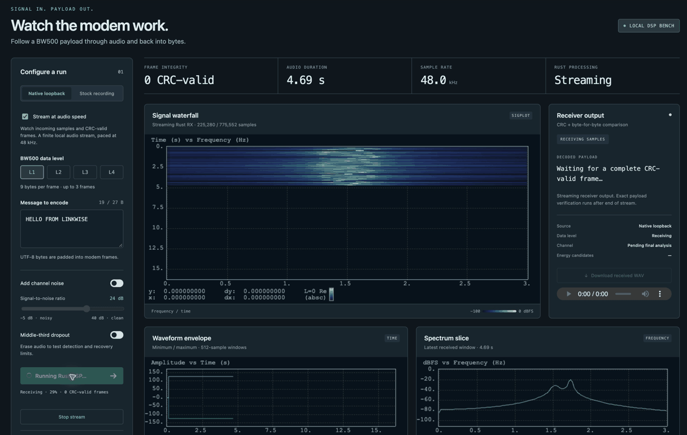

# Linkwise

Linkwise is an independent, cross-platform Rust modem and automated link
control research project. Its long-term goal is to implement a native modem
that interoperates with an unmodified VARA HF installation on macOS, Windows,
and Linux, while enabling AI systems to manage and optimize Winlink links
through safe, observable, policy-controlled tools.

VARA HF is the interoperability target. Linkwise is a separate implementation:
it is not a redistribution of VARA software, decompiled source, or proprietary
assets.

## Run the modem demo

```sh
cd rust
cargo run --locked --features demo --bin modem-demo
```

Open **http://127.0.0.1:8787** for a Rust BW500 encoder/decoder demo with
SigPlot waterfall, waveform, spectrum, audio playback, and exact payload
verification. Try seeded noise and a dropout, or replay verified stock recordings.
This is local codec loopback and capture replay; live VARA interoperability
remains unqualified. See the [demo guide](rust/docs/modem-demo.md) for optional
level-4 inputs, recordings, and implementation details.

### Watch and listen



Screen recording excerpt of the running demo in dark mode: BW500 level 1,
`HELLO FROM LINKWISE`, three frames, clean local audio. The waterfall grows as
samples enter the Rust receiver; the run ends with **3/3 verified**. The GIF is
silent; download the WAV examples below to hear the modem.

| Native Rust modem audio | Duration | Decoded frames |
| --- | ---: | ---: |
| [BW500 level 1 · clean WAV](docs/media/modem/bw500-level1-clean.wav) | 16.16 s | 3 |
| [BW500 level 2 · clean WAV](docs/media/modem/bw500-level2-clean.wav) | 5.15 s | 1 |
| [BW500 level 3 · clean WAV](docs/media/modem/bw500-level3-clean.wav) | 5.11 s | 1 |
| [BW500 level 3 · 24 dB SNR WAV](docs/media/modem/bw500-level3-snr24db.wav) | 5.11 s | 1 |

All four files contain `HELLO FROM LINKWISE` as mono 48 kHz PCM16 audio,
generated by Linkwise's native Rust modem. They demonstrate local codec behavior;
they are not recordings of a live stock VARA or RF connection. See the
[media provenance and reproduction instructions](docs/media/modem/README.md).

## Project vision

The project brings together two related efforts:

1. **Modem interoperability.** Establish the externally observable behavior of
   VARA HF through authorized, controlled reference observations, then build a
   clean-room Rust implementation with deterministic tests and documented
   evidence.
2. **HF propagation operations and research.** Build a practical toolbox for
   selecting VARA HF Winlink gateways and studying 10 m propagation, including
   sporadic-E observations and a carefully separated investigation of whether
   satellite reentry timing correlates with unusual openings.

The propagation work supports the modem work by defining realistic operating
conditions and repeatable experiments. It does not assume that sporadic-E or
reentry events are predictable, global, or suitable as automatic transmission
triggers.

## Automated link-control goal

Linkwise is intended to become an AI-assisted communications system that can
maintain the best available VARA HF/Winlink link for a defined objective. An AI
operator should be able to observe radio and modem state, evaluate available
gateways, select an appropriate channel, prepare the radio, initiate a bounded
Winlink session, monitor its progress, and recover from link failure.

The AI should optimize connectivity using measured and live information such
as:

- current Winlink RMS gateway availability, frequency, mode, distance, and
  bearing;
- VOACAP path predictions and estimated reliability;
- PSK Reporter and DX Maps observations of current 10 m activity;
- GIRO ionosonde and ionospheric measurements;
- radio signal, noise, power, PTT, and audio-interface state;
- VARA modem connection state, negotiated speed, retries, and errors; and
- historical connection success, duration, and throughput for each gateway.

The link manager must maintain labeled, timestamped counts rather than one
ambiguous “number of links”: distinct RMS gateways, distinct gateway channels,
channels eligible for this station, reported-status age, RF sessions attempted
and connected, and client-confirmed message transfers. Outbox totals are
separate and available only where a supported Winlink client interface exposes
them. A listed or recently reporting gateway is not proof of RF reachability;
see the [Winlink tracking design](docs/architecture/winlink-link-tracking-design.md)
for data definitions, integration constraints, and MCP tools.

The intended control architecture is an autonomous MCP-compatible
orchestration layer over Hamlib/`rigctld`, VARA, and Winlink. The AI uses the
complete locally enabled CAT control surface and explicit PTT tools to
configure, operate, monitor, and recover links without routine operator
approval. It acts through Linkwise policy and adapters, not raw device
sockets or unchecked command strings. Human runtime control is limited to an
independent emergency stop; autonomous authority and station limits are
preconfigured and qualified before unattended operation.

Connectivity optimization is therefore an autonomous closed-loop process:

```text
observe → predict → rank gateways → prepare radio/modem
        → authorize from station policy → transmit/session → monitor/recover
        → learn from result → repeat
```

Autonomous control is bounded by a locally enforced station profile:
permitted frequencies/modes, power ceilings, service constraints, session
budgets, retries, and CAT-operation classes. Linkwise issues session and
one-use PTT permits automatically when deterministic checks pass; the AI
cannot change the profile or increase limits. Exclusive radio leases,
readback, audit, independent PTT watchdog/release, and a physical emergency
stop are mandatory. A safety fault causes automatic abort and a latched
receive-only/fault state. Routine operator action is not part of link
management, and no runtime human control other than emergency stop is exposed
while autonomous operation is active.

## Current status

Linkwise is in the research and foundation stage.

- The Rust crate contains an initial stdio MCP radio-control server, a typed
  radio-control port, a `rigctld` adapter, and a non-transmitting simulator
  with in-memory frequency, mode, and power controls.
- Docker Compose profiles define development/simulation and radio-connected
  service stacks; Hamlib source is pinned by release and checksum.
- The stable Rust toolchain, formatter, Clippy, rust-analyzer, and six declared
  cross-compilation targets are configured.
- Research notes, a proposed implementation roadmap, and a propagation-toolbox
  guide are available.
- Static reference analysis and planning are underway.
- Native BW500 level 1–4 waveform/coding primitives, streaming reception,
  setup/control frames, audio-handshake logic, DATA containers, a bounded ARQ
  sender and host-command/data stream transports are implemented. Level 4 uses an external
  measurement profile. Five
  published reference WAV excerpts decode to the expected payloads. Optional
  CPAL input capture is available; complete live modem sessions, payload ARQ,
  and bidirectional stock-VARA interoperability remain unqualified. See
  [modem implementation status](rust/docs/modem.md).
- Compilation does not constitute an interoperability claim.

The authoritative research record is
[lab-notes/lab-notes.tex](lab-notes/lab-notes.tex).

## Architecture and design documents

The proposed AI-assisted radio and Winlink link-management architecture is
documented in the [architecture design set](docs/architecture/README.md). The
stakeholder-oriented [LaTeX whitepaper](docs/whitepaper/linkwise-architecture-whitepaper.tex)
and its [build instructions](docs/whitepaper/README.md) summarize the system
goal, operating concept, use cases, interfaces, safety model, and roadmap.
These documents describe a proposed system; they do not imply the automation
or modem functionality is already implemented.

The design set also proposes a reproducible, virtual-time RF decision
simulator for testing the agent against noisy observations, seeded scenarios,
simple policy baselines, and a truth-informed upper bound. It is intentionally
separate from modem validation: channel-model-based audio tests and inhibited
hardware-in-loop tests are required for those claims. See the
[RF/agent simulation design](docs/architecture/rf-agent-simulation-design.md).

## Research principles

Linkwise treats compatibility as an evidence problem, not an assumption. Each
technical claim should be labeled as one of:

- **DOCUMENTED** — stated by a source or specification;
- **MEASURED** — observed in a reproducible recording or experiment;
- **VALIDATED** — confirmed by repeatable decoding or interoperability tests;
- **HYPOTHESIS** — plausible but not yet confirmed;
- **UNKNOWN** — insufficient evidence.

UI strings, binary cross-references, candidate parameters, generic OFDM
knowledge, and simulations are useful research leads. They are not proof of
VARA protocol semantics.

## Modem engineering goal

The eventual implementation is intended to provide modular, portable Rust
components for:

- host command and data interfaces;
- physical-layer synchronization and waveform analysis;
- modulation, demodulation, coding, framing, and integrity checks;
- link/session behavior and ARQ;
- audio input/output and PTT integration;
- diagnostics, capture analysis, and reproducible regression fixtures.
- AI-facing link orchestration and MCP tool adapters for radio, modem, and
  Winlink state.

The proposed architecture keeps protocol and DSP code separate from
operating-system and device adapters. Candidate waveform parameters and
features such as bandwidth, sample rate, OFDM structure, adaptive levels, ACK
signaling, and coding remain research questions until supported by captures and
interoperability tests. AI control is likewise separated from device drivers:
the model requests typed operations, while Linkwise validates them against
radio capabilities, operating policy, and current link state.

## Propagation and Winlink research

The station scenario described by the propagation work is a Julian, California
station using a 10 m horizontal dipole, approximately 5–10 m above ground,
oriented East–West, with up to 100 W and LMR-400 feedline.

The operational objective is to reach an available VARA HF Winlink RMS gateway;
Winlink can then route the message onward. The preferred decision process is:

1. Refresh the current Winlink RMS gateway/channel list.
2. Rank 10 m VARA gateways by availability, distance, bearing, and service
   code.
3. Run a separately documented VOACAP prediction for each candidate gateway.
4. Compare the prediction with live PSK Reporter and DX Maps activity.
5. Inspect relevant GIRO ionograms or derived ionospheric data.
6. Record KeepTrack reentry information only as a separate experimental event
   marker.
7. Attempt a short, legal, clear-channel Winlink connection and log the result.

The [propagation toolbox](reference/propagation-toolbox.md) documents the
referenced tools, their roles, access methods, automation constraints, and
provenance requirements. It distinguishes model predictions, live radio
observations, ionosonde measurements, gateway state, and orbital event data.

## Evidence and safety boundaries

Dynamic modem tests should use an audio loopback, shielded setup, or conducted
test arrangement that prevents unintended radiation. Reference software and
captured material must be used only within the applicable authorization,
license, and legal boundaries. Do not transmit VARA on an FT8 frequency merely
to generate propagation reports; use a published, permitted Winlink channel.

The reentry/sporadic-E relationship is an unverified research hypothesis.
KeepTrack is an event-timing source, not a propagation forecast. A useful test
requires repeated events, non-event control periods, independent 10 m
observations, and timestamped records of both successful and failed attempts.

## Repository layout

```text
.
├── rust/                         Linkwise Rust crate
├── lab-notes/                    Research log and progress presentation
├── docs/
│   ├── architecture/             System design documents
│   └── whitepaper/               LaTeX paper and PlantUML diagram sources
├── reference/
│   ├── propagation-toolbox.md    Propagation-tool documentation
│   ├── vara/                     Local VARA reference materials
│   └── ghidra/                   Local Ghidra analysis resources
├── tools/                        Environment and VM support scripts
├── .vscode/                      Workspace MCP, editor, and task settings
└── rust-toolchain.toml           Pinned Rust channel/components/targets
```

Large vendor-supplied binaries, generated build output, local VM state, and
proprietary reference bundles are intentionally excluded by
[.gitignore](.gitignore). They may remain available in a local research
environment without becoming part of the source distribution.

## Development

Install the stable Rust toolchain with rustup, then work from the Rust crate:

```sh
cd rust
cargo fmt --check
cargo clippy --all-targets -- -D warnings
cargo test
```

The complete configured verification sequence is available in VS Code as
`Linkwise: verify`. The repository currently checks these targets:

```text
aarch64-apple-darwin       x86_64-apple-darwin
aarch64-pc-windows-msvc    x86_64-pc-windows-msvc
aarch64-unknown-linux-gnu  x86_64-unknown-linux-gnu
```

Cross-target compilation is necessary but does not replace native execution,
audio-device validation, PTT testing, or reference interoperability tests.

## Containerized radio-control services

Project services are developed and run through Docker Compose. The development
profile uses a non-transmitting simulated radio. Its frequency, mode, and
power controls update only in-memory state:

```sh
docker compose --profile dev run --build --rm -i linkwise
```

VS Code can connect to this stdio server through the
`linkwise-simulated-radio` entry in `.vscode/mcp.json`. Reload workspace MCP
servers after changing that configuration.

For radio-connected use, set `RIGCTLD_HOST_DEVICE`, `RIGCTLD_MODEL`, and
`LINKWISE_RADIO_BACKEND=rigctld`, then start Hamlib and launch the MCP service:

```sh
docker compose --profile radio up --build -d hamlib
docker compose --profile radio run --rm -i -e LINKWISE_RADIO_BACKEND=rigctld linkwise
```

Configure the station limits described in the architecture. CAT writes are
disabled by default and denied unless explicit frequency, mode, and power
limits are configured. Hamlib is reachable only on the Compose network and is
not published to the host. See
[`compose.yaml`](compose.yaml) and [`containers/hamlib.lock`](containers/hamlib.lock).

Physical device pass-through and emergency-stop qualification remain
platform-specific work. The radio Compose profile does not imply that every
host OS supports direct device pass-through to containers.

## Roadmap

The planned sequence is intentionally gated by evidence:

1. Establish an authorized reference runtime and controlled audio capture.
2. Build a traceable corpus of authentic VARA HF observations.
3. Implement deterministic WAV handling and waveform/spectrum analysis.
4. Characterize and test synchronization and receiver behavior.
5. Characterize framing, coding, modulation, and data decoding.
6. Implement a transmitter accepted by an unmodified reference receiver.
7. Add ARQ, session management, host interfaces, audio, and platform support.
8. Add read-only AI/MCP observability for radio, VARA, Winlink, and propagation
   state.
9. Add policy-controlled link preparation, gateway ranking, bounded sessions,
   failure recovery, and historical connectivity optimization.
10. Harden, document, and release only the modes and platforms actually tested.

The full proposed plan, exit criteria, blockers, and corpus policy are in the
[lab notes](lab-notes/lab-notes.tex).

## Project status and licensing

Linkwise is research software and is not yet a functioning replacement modem.
No project license has been selected in this repository yet. Before a public
release, the project must review the licenses and trademarks covering Linkwise,
reference software, captured data, dependencies, and distributed tooling.
