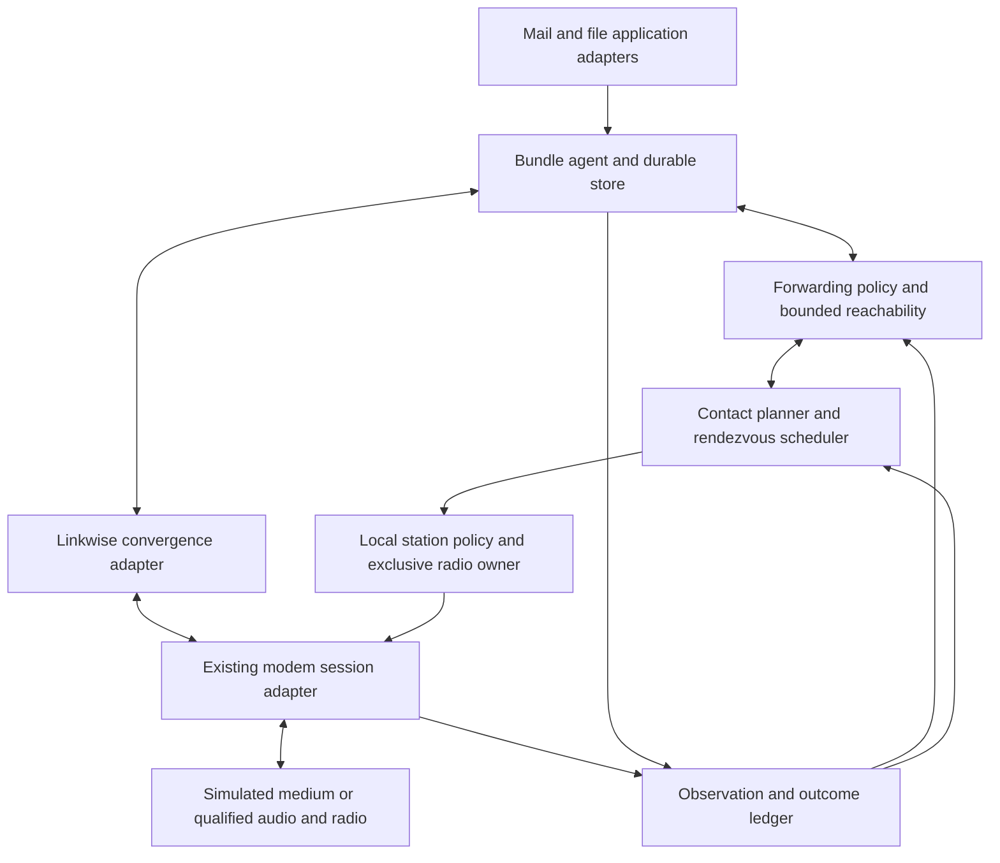

# Adaptive Linkwise network implementation plan

**Document ID:** LINKWISE-PLAN-NET-001

**Version:** 0.2, proposed

**Reviewed:** 19 November 2026

**Implementation baseline:** `24c50964e8f1b727cc01181efab731a71667a9dd`

**Status:** Partial implementation with a [Rust network bench, reproduction commands and measured results](../../rust/network/README.md). The baseline inventory below describes the original checkout.

## 1. Decision and intended outcome

Implement an intermittently connected, store-and-forward Linkwise overlay with
adaptive radio contacts and distributed forwarding. Start with fixed or slowly
moving HF stations. Add optional IP backhaul as another explicitly modeled
bearer. A message may cross several contacts separated by hours; an instantaneous
end-to-end route is not required.

The network controls peer selection, eligible frequency, rendezvous, session
duration, relay choice, and waiting. It cannot control propagation. Separate the
**potential contact graph**, the **scheduled/active contact graph**, and the
**message forwarding graph** in the implementation and results.

Success means more priority-weighted application data delivered before deadline
under equal radio, airtime, storage, and energy limits, with recoverable durable
state and bounded behavior during partitions. A connected globe or successful
modem connection is not the acceptance criterion.

This extends the [RF decision-simulation design](rf-agent-simulation-design.md).
It introduces a separate Linkwise overlay; it does not replace Winlink CMS/RMS
routing or imply that a standard Winlink client speaks the new overlay.
Research, source provenance, and current test limitations are in the companion
[research and implementation evidence review](adaptive-network-research-and-evidence.md).

## 2. What exists and what must be built

The following describes source at the baseline commit, not merely architecture
intent. Paths below are relative to the repository root.

| Component | Actual state | Implementation consequence |
| --- | --- | --- |
| `rust/src/winlink/session.rs` | Bounded B2F P2P exchange over an established byte stream; `Mailbox::store` requires durability | Reuse transport/application boundaries and failure patterns; B2F acceptance is not an overlay destination receipt |
| `rust/src/winlink/mailbox.rs` | Persistent inbox/outbox/finished, duplicate checks, synced publication; `outgoing` requires every recipient to equal the directly connected peer | Keep existing behavior; create network forwarding and per-destination state separately |
| `rust/src/host.rs` | Bounded modem host commands and byte-stream backpressure | Adapt established link sessions; do not infer radio delivery from socket writes or `BUFFER 0` |
| `rust/src/modem/runtime.rs`, `runtime/device.rs` | Explicit-time session core, byte accounting, simulated device and release lifecycle | Reuse concepts and contracts in deterministic tests; not a complete live-wire modem qualification |
| `rust/src/bin/linkwise-modemd/virtual_host.rs` | Separate `Engine`, Tokio wall-clock deadlines, pairwise virtual PCM cable, native-audio service path | Deliberately integrate this engine; a simulator using only portable `Runtime` does not exercise it |
| `rust/src/radio.rs`, `rust/src/mcp.rs` | CAT/readback adapters; key-up currently denied; MCP reports `watchdog_active=false` | Autonomous physical transmission is gated on further station-control work |
| `rust/src/pki.rs`, `pki/chat_tls.rs` | Configured station identity, trust and authenticated chat primitives | Reuse identity verification where suitable; topology advertisements and offline trust lifecycle remain new work |
| Existing architecture/SRS | Inventory, scheduler, leases, event persistence, RF decision simulator described as proposals | Convert requirements to tested code; do not count document text as implementation |
| Global overlay | No bundle router, contact scheduler, shared RF medium, relay receipts, or topology controller found | New subsystem with its own tests and release boundary |

The native/virtual engine currently has a 4,096-byte buffer bound, 100 ms host
batching, a 12 s phase timeout, and bounded query/turn recovery. These are current
implementation constants, not measured global-network capacities. Streaming a
large object requires adapter backpressure and repeated deliveries.

## 3. Proposed architecture and ownership

### 3.1 Protocol and dependency decision

**Proposed ADR NET-001:** target a documented BPv7 subset for network envelopes.
Do a bounded integration spike with `dtn7-rs` before selecting it as a runtime
dependency. Use NASA ION as an independent interoperability reference. Do not
write an entire new bundle protocol or select a dependency on feature claims
alone. NASA HDTN is an archived reference, not the default maintained runtime.
See research references R01–R06 and R12.

The spike must demonstrate exact binary payload exchange, malformed-input bounds,
expiry, duplicate and fragment behavior, restart durability, external forwarding
and convergence-layer control, target-platform builds, dependency/license review,
and interoperation with a separately implemented peer. Pin a tested revision.
Evaluate both an external daemon and library integration. Disable unused network
listeners and automatic discovery in isolated tests.

Select exactly one authoritative bundle store. If a selected bundle agent owns
durable state, the Linkwise ledger mirrors outcomes but must not independently
decide deletion. If it fails the spike, record the failure and evaluate a BPv7
codec with a Linkwise-owned transactional spool. A small SQLite-backed store with
payload and metadata in one transaction is a candidate, not a present dependency.
Benchmark durable commits on target storage before choosing defaults.

BPv7 does not provide application processing confirmation, nor does it by itself
provide the durable relay acceptance contract below. BIBE custody work is still
an Internet-Draft in the reviewed sources; it is not assumed as a finalized
interoperability requirement. Keep any Linkwise-specific receipt protocol
explicitly versioned and distinct from standard BP status reports.

Record the Rust implementation boundary in M0. For a fully Rust production stack above the OS/device interface, verify transitive native libraries, storage and target-specific CAT/PTT drivers. Keep independent reference peers in the test environment.

### 3.2 Proposed module boundaries

Start under `rust/src/network/` behind an opt-in `network` feature, after the
dependency spike; these names are proposed, not existing interfaces:

| Module | Responsibility |
| --- | --- |
| `types`, `identity`, `profile` | Node/application identifiers, endpoint mapping, commissioned capabilities, limits and protocol versions |
| `bundle`, `store`, `receipts` | Selected BP integration, durable lifecycle, bounded reassembly, duplicate/conflict handling and acknowledgments |
| `routing` | Static, earliest-arrival and measured-cost policies; explicit wait/no-route decisions |
| `contacts`, `rendezvous`, `scheduler` | Predicted/observed opportunities, mutual scheduling, channel/radio reservations and backoff |
| `control` | Bounded, authenticated, expiring neighbor/reachability/capacity advertisements |
| `adapters` | Existing modem service, fake sessions, optional IP bearer, application and later B2F boundary adapters |
| `sim` | Discrete-event world, hidden channel conditions, traffic and failure generation, evaluator |
| `events` | Versioned provenance, observations, decisions, attempts, storage transitions, outcomes and metrics |

Use pure policy/state transitions with injected time and I/O. A proposed
`linkwise-netd` service owns local networking actors; a proposed
`linkwise-net-sim` executable owns scenarios and virtual time. Neither executable
exists yet. The simulator must not instantiate real CAT/PTT drivers.

### 3.3 Durable message and delivery semantics

Keep destination endpoint, current next hop, radio callsign, and authenticated
node identity distinct. Commission initial identities and peers offline. Pin a
common BP naming profile in the interoperability fixture; account for RFC 9758
if `ipn` identifiers are used. Callsign strings alone are not authentication.

For each application object retain a stable ID, payload hash, destination,
priority, creation/lifetime information, size, application type, and receipt
policy. A same-ID/different-content submission is a conflict, not a duplicate.
Use the selected BP implementation's standard identity for bundles/fragments;
do not substitute an application hash for BP identity.

Persist separately: local admission, partial transfer progress, relay acceptance,
destination application acceptance, receipt return, expiry and explicit discard.
Commit payload and acceptance state before returning a durable relay receipt.
Never delete the last retained copy merely because the local modem acknowledged
bytes. Sender deletion after relay acceptance transfers responsibility under the
documented failure model; it is not proof against loss of the relay's disk.
Higher durability requires separately budgeted replication or retained originals.

Crash tests must cover failure before/after each durable commit and receipt,
including an acknowledgment lost after receiver commit. Retransmission then
produces a duplicate acknowledgment, not duplicate application effects. The
application adapter must atomically deduplicate by object ID or use an idempotent
application operation; arbitrary external applications cannot be promised
exactly-once side effects. Bound duplicate tombstones and receipt retention by
the declared lifetime/replay model. Reject messages outside that model.

Define a BP clock profile: when creation time is zero, include the required
Bundle Age Block; uncertain local time must not silently extend lifetime. Persist
accumulated residence time and handle restart/offline intervals conservatively.
Test backward/forward wall-clock jumps separately from monotonic session timers.
Receipts carry authenticated object-ID/hash correlation and a bounded return
lifetime. Do not request receipts for receipts; preserve BP administrative-record
status-report restrictions to prevent recursive control traffic.

### 3.4 Link adapter and transfer profile

Carry network traffic over established Linkwise peer byte streams without
changing the modem waveform. Negotiate network mode between participating peers;
do not send bundle bytes into an ordinary B2F session. Bound every record length,
bundle size, parser allocation, partial transfer, and timeout. Validate object
integrity after reassembly. Network framing must tolerate arbitrary TCP read
boundaries and session loss.

Specify a minimal Linkwise convergence-layer profile during milestone M1:
capabilities/version negotiation, transfer identity, bounded segmentation,
durable acceptance/rejection, progress reconciliation after reconnect, and
teardown. Either implement transfer resumption or use bounded independent
application chunks so interruption cannot force every large object to restart.
Charge segment headers, receipts and negotiation to airtime. This profile is new
engineering and requires separate wire tests; it is not STANAG 5066 or ALE
conformance. Use TCPCLv4 only on a suitable TCP bearer; loopback TCP modem control
sockets do not make the underlying HF transfer TCPCLv4-compliant.

### 3.5 Contact establishment and topology control

For the initial six-node system, commission peers and use deterministic shared
rendezvous schedules, clock-error guard intervals, and a fallback listening
schedule. No Internet service may be required to find a peer after a partition.
Avoid starting with universal dynamic discovery or an implementation of standard
ALE. Later adapters may use independently qualified ALE equipment.

Contact negotiation uses a caller/responder tie-break, proposal ID, short expiry,
mutual acceptance and local exclusive radio reservation. Reservations are local
and soft-state; they do not imply a distributed atomic transaction. On ambiguous
negotiation or clock mismatch, release/expire reservations and return to the
fallback schedule. Test simultaneous callers, lost accepts, stale reservations,
restart and clocks outside the permitted uncertainty bound.

Advertise only bounded summaries: reachable destinations/regions, supporting
evidence age, next contact estimates and uncertainty, queue pressure, available
storage, supported modes, and schedule versions. Cap advertisements per contact
and per unit time; suppress unchanged state and piggyback when useful. Reuse
actual transfer feedback. Keep authenticated membership, sequence/epoch replay
protection, expiry and per-peer rate limits separate from route ranking.

A node may prefer a different peer/frequency only when expected benefit exceeds
setup/switching cost and a configurable hysteresis margin. Retain a fallback;
do not retune an active transfer. Give urgent traffic a defined preemption rule
at safe boundaries. Exploration consumes a fixed budget and cannot starve data.

### 3.6 Routing and congestion

Implement in order: static commissioned relays; time-dependent earliest-arrival
routing on known schedules; measured-cost routing with stale-data penalties;
queue-aware adaptive contact selection. HF forecasts are uncertain opportunities,
not guaranteed reservations. Route computation must respect both endpoints'
radio schedule, store capacity, setup time and expected usable contact volume.
Account for reverse acknowledgments, failed attempts and interrupted sessions.

Use hop/lifetime limits, duplicate suppression and bounded retry state even when
route algorithms are nominally loop-avoiding. Distinguish a temporary revisit
from useful delayed forwarding; do not import a continuously connected routing
algorithm without its assumptions. Do not multiply link probabilities as if
regional propagation failures were independent.

Apply per-peer/application quotas, admission control, queue age/deadline policy,
storage reservations and explicit congestion rejection. Include anti-starvation
service for low-priority and poorly connected nodes. Start with single-copy
forwarding; evaluate bounded replication as a separate policy with identical
resource accounting. No epidemic flooding in the default network.

For global scale, begin with commissioned regions and gateway mappings; advertise
summaries across regions rather than all pairwise links. Test border failure,
multi-homing and partitions. Automatic region formation and inter-domain trust
are later work; neither BPv7 nor the reviewed ION guide supplies a complete
automatic global hierarchy.

### 3.7 Station autonomy and security

Follow the existing SRS: commissioning installs authority; normal autonomous
runtime does not require per-session approval. Human runtime actuation remains
the independent emergency stop. Before physical operation implement and qualify
the local exclusive radio lease, verified tuning, session authorization, bounded
PTT arbiter, duty/timeout limits, release readback and independent watchdog/inhibit.
Current denied key-up must remain denied until those conditions are implemented.

Profile eligibility covers channel/service authority, permitted traffic and
security modes, operating times, power and hardware capabilities. A route cannot
override it. Reuse PKI only after defining identity binding, replay protection,
key rotation, offline revocation and compromised-relay behavior. Authentication,
payload confidentiality and metadata minimization are distinct profile choices;
do not assume the existing encrypted chat profile is suitable for every RF
service. Apply parsers and resource quotas before trusting advertised capacity.

## 4. Simulator implementation and fidelity

Use a Rust discrete-event harness for the shared policy code. Implement integer
virtual time and stable event ordering, e.g. `(time, priority, node_id, sequence)`.
Separate evaluator-only world state from node observations. Key environmental
random streams to path/band/time/phenomenon, not to policy call count; differing
actions must not shift the weather or noise sequence for another policy.
Record observations/actions for replay when an external agent is nondeterministic.

Model radio count, tune/listen/scan state, duplex constraints, setup/acquisition,
turnaround, ARQ, idle receive and transmit energy, storage and queue limits.
The medium must compute receiver-specific overlapping transmissions, hidden
terminals and interference footprints. Do not serialize every global transmission
on one channel or treat every pairwise cable as interference-free.

Use propagation-tool output as a versioned prior, then add correlated time/band/
regional variation and outages. Keep local noise, asymmetric receive conditions
and forecast bias separate. Unknown parameters get sensitivity ranges; they do
not receive narrow confidence bounds derived from selected beacon clips.
Distinguish receiver-service availability from RF path quality.

Use four levels: event-only correctness; statistical session/network simulation;
selected real modem/audio sessions; inhibited hardware and then commissioned
field trials. Waveform-level processing for every global edge is unnecessary.
The actual `virtual_host::Engine` must be exercised at the modem-in-loop level.
Initially use a wall-clock process adapter with observed timings; extract clock/
transport interfaces into a library as a separate regression-protected change.
Do not equate portable-core simulation with actual-engine validation.

ONE is an optional independent DTN algorithm comparison. OMNeT++/INET is an
alternative if MAC/PHY modeling dominates; ns-3 is another candidate requiring
HF-specific models. Reuse calibrated session distributions for large runs. Any
cross-simulator comparison must share traffic/contact traces and semantics.
See R13–R16 for prior HF simulation and uncertainty treatment.

## 5. Implementation milestones and exit evidence

Milestones are dependency-ordered work packages, not calendar promises. A failed
gate produces a defect or scope decision; it cannot be passed by a demonstration
video or documentation update.

### 5.1 Network requirements and verification trace

These are proposed requirements for the overlay. Verification evidence must
identify the tested build, fixture and result; a test name alone is insufficient.

| Requirement | Required behavior | Verification / owning milestone |
| --- | --- | --- |
| NET-001 | Preserve object identity, destination, integrity and lifetime independently of next-hop choice | Binary interchange, conflict and expiry tests; M0–M2 |
| NET-002 | Acknowledge durable relay acceptance only after recoverable commit; never equate modem ACK with destination acceptance | Commit/ACK/delete crash matrix; M1 |
| NET-003 | Bound duplicate application effects, replicas, receipt traffic, hop count and reassembly resources | Replay/receipt recursion, oversized-fragment and quota cases; M1–M2 |
| NET-004 | Recover queues and partial transfers after restart without silently extending object lifetime | Restart, unknown-clock and reconnect reconciliation; M1–M2 |
| NET-005 | Account for single-radio tuning, both endpoints' availability and receiver-specific interference | Exclusivity, hidden-terminal and capacity fixtures; M3 |
| NET-006 | Establish contacts and return to a fallback schedule without requiring Internet availability | Lost negotiation, clock error and complete-backhaul-outage cases; M3 |
| NET-007 | Carry and charge discovery, route, receipt and retry traffic through modeled bearers | Event/byte/airtime ledger reconciliation; M3–M4 |
| NET-008 | Enforce commissioned authority, authenticated identity, replay limits and local resource admission independently of ranking | Forged/stale control, compromised-peer quota and denied-action tests; M1, M3, M8 |
| NET-009 | Expose select/wait/no-route decisions with evidence age, version, uncertainty and reason | Decision trace reconstruction; M2–M4 |
| NET-010 | Separate node-visible published forecasts from evaluator-only future realizations | Observation-boundary inspection and leakage fixtures; M2–M5 |
| NET-011 | Reproduce environmental conditions independently of policy action ordering | Paired-seed world replay, stable event and trace checks; M2–M5 |
| NET-012 | Report offered-load on-time delivery, source confirmations, overhead, fairness and all losses separately | Independent evaluator reconciliation and held-out matrix; M4–M5 |
| NET-013 | Exercise the actual service engine before assigning measured session calibration to the simulator | Modem-in-loop build/profile/role comparison; M6 |
| NET-014 | Qualify every enabled application/gateway boundary and disclose ambiguous downstream acceptance | Adapter idempotency/retry cases; M7 |
| NET-015 | Preserve independent emergency stop and bound physical transmission under local policy | Existing OVR safety trace plus measured hardware fault tests; M8 |

### 5.2 Delivery sequence

| ID | Deliverable and dependencies | Exit evidence |
| --- | --- | --- |
| M0 | Freeze baseline, evidence index, traffic classes and protocol/store spike | Pinned dependency ADR, platform/license review, independent-peer binary interchange, crash/durability report, known unsupported features; baseline source and data hashes |
| M1 | Bundle/store/receipt model, fake bearer, bounded convergence profile; M0 | Exact binary objects through two peers; crash matrix; duplicate/conflict/expiry/quota tests; reconnect progress; parser/fuzz bounds; no premature final-delivery claim |
| M2 | Six nodes, scripted contacts, static forwarding, virtual clock; M1 | All admitted objects accounted for; no-radio-driver simulator; deterministic trace digest; restart/partition/rejoin and receipt-loss cases pass |
| M3 | Shared medium, rendezvous negotiation and resource scheduling; M2 | Hidden-terminal and simultaneous-call tests; no overlapping use of a single radio; all control costs charged; abandoned reservations expire; clock/fallback recovery |
| M4 | 30-node adaptive routing/contact policies; M3 | Paired comparison and ablations against baselines; held-out failure scenarios; confidence intervals, worst-node service and overhead; conditions of regression documented |
| M5 | 100 then 1,000 nodes with regional summaries; M4 | Sparse candidate discovery coverage, partition recovery, border failover, bounded state; CPU/memory/event-count/runtime measured on named hardware |
| M6 | Actual-engine modem adapter and calibration; M1–M3, selected M4 scenarios | Same application bytes and receipts over actual modem paths; role/reconnect/recovery matrix; abstract-versus-measured setup/time/goodput error; source/profile hashes |
| M7 | Application adapters, optional IP and Winlink boundary; M1, M6 | Per-recipient mapping, no gateway relay loops, deduplicated local enqueue; downstream idempotency or explicit ambiguous-acceptance/retry policy; return receipts and RMS/CMS qualification boundary |
| M8 | Qualified station and bounded multi-site deployment; M4, M6 and enabled M7 adapters | Independent PTT/release/watchdog evidence; precommissioned policy; known-transmission field denominator; offline recovery; site/season holdout and operational runbook |

Start M6 timing measurements as soon as M1 can exchange an object. Use held-out measurements of setup, useful bytes per contact, recovery and teardown to check whether policy rankings survive realistic costs.

M5 statistical scaling may proceed before M6 calibration, but its output stays
labeled synthetic. M8 claims depend on measured calibration and station evidence.
Optional Internet/Winlink gateway qualification does not block a peer-only trial.
Arbitrary SMTP recipients cannot be promised exactly-once submission after an
ambiguous remote acknowledgment; the gateway must expose that uncertainty.

### 5.3 First six-node acceptance scenario

Use A–F with two possible branches A–B–C–F and A–D–E–F. Script successive
contact windows so no complete instantaneous route exists; provide a separate
case where waiting for A–D is preferable to immediately forwarding to B.
Specify contact capacities and object sizes so the expected outcome is manually
checkable. Include binary objects below and above one transfer segment, mixed
priorities and an object whose deadline is deliberately impossible.

Test clean delivery, loss midway through a transfer, receiver crash after commit
but before receipt, relay restart, lost return receipt, full storage, duplicate
submission, conflicting content ID, revoked peer, clock jump/unknown time,
expired message, and partition rejoin. Route advertisements and receipts use the
same constrained channels as payload. The evaluator may inspect future windows;
node actors may see issued forecasts and published future schedules, but not
latent future contact realizations, noise or failures.

Require exact object hashes, one idempotent application acceptance per ID,
bounded replicas, correct expiry, no falsely reported source confirmation, and
an explanation for every object not delivered. A queued object is not a loss;
an unexplained disappearance is a failure.

For a hand-checkable oracle fixture, offer one object at A at minute 0 with
deadline minute 20. Give every contact one minute and capacity for one complete
object including setup and hop acknowledgment. Publish A–B at minute 1, B–C
at 8, C–F at 25, A–D at 4, D–E at 6 and E–F at 9. Under single-copy forwarding
with successful contacts, waiting for D delivers at minute 10. Committing to B
misses the deadline. Schedule a separate return path for the destination receipt
and repeat with that path removed. F's delivery time must agree in both runs.

### 5.4 Evaluation matrix and proposed research thresholds

Compare fixed schedules/static forwarding, fixed schedules/adaptive routing,
adaptive contacts/static forwarding, joint adaptation, and separately bounded
replication. Include a simple direct/gateway forecast-and-retry policy inspired
by Winlink Hybrid, explicitly labeled a surrogate unless actual RMS behavior is
measured. Do not claim to reproduce Winlink's proprietary routing internals.
Use a constrained future-aware optimizer only for small tractable scenarios.

Test sparse/dense layouts, diurnal/seasonal change, correlated regional outage,
interference, asymmetric links, stale or forged advertisements, missed contacts,
storage/power loss, flash crowds and IP-backhaul disappearance. Traffic spans
small urgent messages, normal mail and chunked files. Freeze sizes, deadlines,
arrival processes and priority weights in the scenario manifest.

Start with at least 30 paired environmental seeds per family and expand if the
interval is too wide. Hold out whole sites, dates and source sessions; injected
noise repetitions of one frame do not become independent field samples. Report
paired uncertainty over independent scenario/source clusters. Perform a fixed
pilot followed by a frozen final run rather than stopping at a favorable score.

Suggested M4 target, to freeze after a disjoint pilot: at least 10% relative
improvement in priority-weighted on-time delivery over the strongest simple
baseline on declared stressed families, with the paired 95% interval above zero;
no more than two percentage points of absolute degradation on declared benign
families; control airtime at most 10% of each node's available radio time in the
nominal profile. These are proposed engineering targets, not literature-derived
guarantees. Report low-baseline absolute changes and sweep the thresholds. If
adaptation fails, retain simpler routing and document why.

## 6. Required results, provenance and calibration data

Primary score = sum of prespecified weights of unique on-time objects divided by the sum of weights of all offered objects. Score a reassembled application object once. Define on-time by destination durable acceptance at or before its deadline. Report source confirmation independently. For zero baseline delivery use absolute percentage-point differences. Report per-node control airtime divided by occupied transmit airtime as well as by available radio time, with idle nodes identified.

Also report the fraction and priority-weighted value of generated application objects
delivered by deadline. Include disconnected and admission-rejected traffic in
the offered-load denominator; also report an admitted-load denominator. Report
payload bytes separately so fragmentation or tiny objects cannot inflate success.

Separate evaluator-observed destination acceptance, source-observed receipt and
external application processing. Include undelivered traffic, deadline expiry,
censoring and queue age; delivered-only latency percentiles are insufficient.
Also report useful goodput, setup/retry/control airtime, idle/receive/transmit
energy, topology churn, recovery time, storage peaks, fairness and minimum node
service. Hard constraints include prohibited RF actions, parser/memory bounds,
single-radio exclusivity and data-accounting invariants.

Every run manifest records code/dependency/profile versions, environmental seed
mapping, node placement and antenna assumptions, traffic, channel/propagation
model, source artifacts/hashes, clock model, policy/configuration, calibration
split, hardware/runtime and observation coverage. Store immutable event traces;
large artifacts need content hashes, retrieval instructions and retention rules.
Missing observations remain missing, not zero-success opportunities.

Collect the following before fitting operational HF contact distributions:

- Known offered calls/transmissions with peer, UTC, band, mode, profile, power,
  antenna assumptions and endpoint availability; retain failed attempts.
- Connection/setup and retune/scan times, bytes offered/acknowledged/durably
  accepted/delivered, session interruption and teardown, receipt round-trip time.
- Queue/storage state, control bytes and airtime, channel occupancy, noise/SNR
  definition and calibration, watchdog/release outcomes and source continuity.
- Repeated paths across times/seasons/sites, with holdouts fixed before tuning.

Existing KiwiSDR clips support decoder regressions and selected impairment
studies. They do not establish a global link-existence model, absolute RF SNR,
end-to-end delivery probability or relay capacity. Existing isolated transfer
fixtures are useful calibration starting points only after timing/pace/role and
binary versions are normalized.

## 7. First implementation slice and unresolved decisions

The first code change should deliver M0's pinned dependency decision and M1's
minimal durable two-peer exchange, followed by M2's six-node executable fixture.
Keep these independently reviewable from waveform changes. Subsequent changes
add medium contention, adaptation and scale in that order. Update the SRS with
`NET-*` requirements and test traceability when interfaces are selected; preserve
the existing `OVR-*` requirements and autonomous-control model.

Decisions to resolve in M0: BP agent integration/store owner, endpoint naming,
receipt durability/failure model, object/segment limits, initial traffic envelope,
commissioned RF service/security profiles, supported target OSs and first
deployment sites. Resolve through explicit ADRs and measurements; none prevents
the deterministic no-RF correctness work.

Plan completion means the source/evidence review and implementation gates are
documented and linked. Network completion requires the M1–M8 evidence above.
Require M5 scale and M8 multi-site evidence together for a global deployment claim. A successful regional pilot supports only its tested sites and conditions.
No current result qualifies the global network or autonomous physical station.
