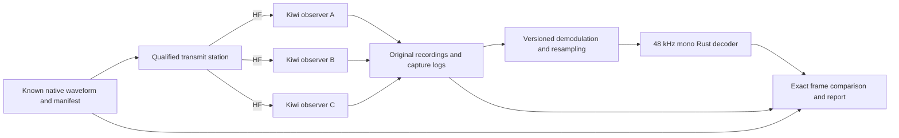
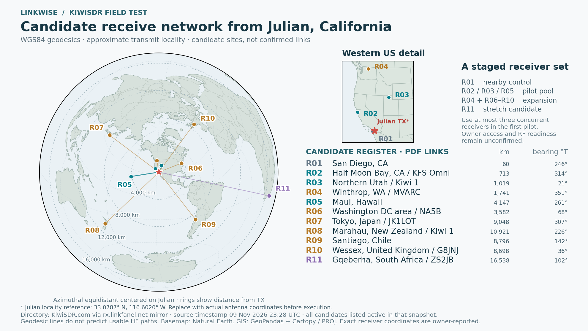

# Draft: Linkwise modem testing with the KiwiSDR network

Plan ID: LW-MODEM-KIWI-001  
Revision: 0.7, 9 November 2026  
Status: proposed experiment; eleven candidate sites shortlisted from directory data; no recording windows agreed, recordings acquired, or RF tests performed under this plan.

Presentation rule: all figures, tables, and diagrams in the LaTeX/PDF edition
use dedicated landscape pages, scaled within both page dimensions with room for
captions. Keep text readable; restructure a crowded visual rather than relying
on extreme downscaling. This rule also applies to future additions.

## 1. Objective and evidence boundary

Use geographically separated KiwiSDR receivers to capture known Linkwise
transmissions, measure one-way frame recovery under actual HF conditions, and
build a reproducible decoder regression corpus. Test the native modem first;
agent chat, global routing, and message-service behavior are outside this plan.

A successful observation means that a specified receiver captured an actual RF
transmission and Linkwise recovered the expected frame bytes. It does not prove
bidirectional connectivity, stock VARA acceptance, a working ARQ session, remote
message receipt, or agent processing. Kiwi receivers are observers, not modem
peers issuing acknowledgments. Any later stock-decoder comparison is a separate
experiment with a qualified reference instance.

Use three distinct evidence labels:

- **Synthetic:** local waveform generation, impairment injection, and replay.
- **RF observation:** remote recording of a physically transmitted known waveform.
- **Operational link:** a separate, qualified two-station exchange, not established
  by this plan.

## 2. Current implementation and prerequisites

The [modem guide](modem.md) is the implementation baseline. The current decoder
accepts 48 kHz mono PCM16 or float32 WAVs. The receiver has a fixed 1% full-scale
RMS acquisition threshold, no AGC or frequency/sample-clock tracking, and bounded
30-second history. Level 4 requires an external measurement profile and currently
handles one frame per burst. Preserve these limitations in every report.

Available now:

- Native level 1–3 synthesis and streaming decode; optional level-4 components.
- `linkwise decode-wav` and JSON frame reports containing level, control, payload
  hex, and sample ranges.
- Local [SigPlot demo](modem-demo.md), known waveform examples, and fixture tests.

Needed before an RF campaign:

- A qualified station playback/radio/PTT path, operator, and permitted test
  configuration. The web demo does not key a transmitter, and optional CPAL
  capture is not an integrated operational transmit service.
- A cooperating receiver registry with owner-agreed automated capture windows,
  slot/time limits, settings, and retention/publication terms. Public listing
  alone is not permission for an unattended campaign.
- A pinned KiwiClient revision, capture continuity instrumentation, deterministic
  conversion, manifest generation, and expected-frame comparison tooling.
- A verified physical local transmit monitor recording, plus transmitter start,
  stop, and fault evidence. Generating a WAV alone does not confirm RF emission.

Do not automatically key a radio or occupy public receivers to execute this
written plan. Campaign execution is a subsequent station operation.

## 3. Measurement architecture



Use KiwiClient/`kiwirecorder.py` as the initial capture adapter rather than
browser audio playback or desktop sound recording. Upstream supports audio,
IQ, and waterfall capture, including multiple receivers. IQ Kiwi-WAV recording
can retain GNSS timestamp chunks; validity must be checked before timing use.
The recorder exposes gain/AGC and compression settings and has multiple
resampling paths. Pin the client and record which path actually executes.
Sources: [KiwiClient README](https://github.com/jks-prv/kiwiclient/blob/master/README.md),
[recorder source](https://github.com/jks-prv/kiwiclient/blob/master/kiwirecorder.py).

The publication edition includes five proposed PlantUML views (measurement chain,
physical setup, capture-processing branches, observation scoring, and K0–K5 gates)
and two TikZ schematics (burst timing and signal annotation). Sources are in
`docs/testing/diagrams/` and `docs/testing/figures/`. The signal annotation is a
conceptual illustration, not measured RF data; no receiver locations or global
coverage map are invented before site selection. All views use landscape pages.

These are source capabilities, not evidence that any particular public receiver
currently supports, permits, or has capacity for the selected capture profile.

## 4. Receiver selection and recording profiles

For the first pilot, seek three cooperating receivers: one relatively short
path and two geographically different longer paths where available. At least
one intercontinental observation is a later coverage objective, not a prerequisite
for validating the capture pipeline. Record distance, bearing, UTC window,
antenna information, and path evidence; do not infer availability from distance.

Select receivers using a registry snapshot, then preflight each endpoint.
Do not hard-code an assumed global receiver count. Re-check access rules,
frequency coverage, time limits, slots, clock information, and effective settings
at each session. A failed preflight is an infrastructure exclusion, not an RF
non-detection. Cap the pilot at three simultaneous streams, one slot per receiver,
with an explicit stop deadline; never evade passwords, kicks, or time limits.

**Profile A — initial audio capture:** uncompressed USB audio; no squelch;
noise blanking, noise reduction, de-emphasis and other optional processing off
where supported. Use a fixed documented passband that contains the complete
synthesized waveform, with margin. Fix gain where practical; otherwise record
AGC configuration and label the run accordingly. Verify gain does not clip.

**Profile B — later diagnostic IQ capture:** original complex samples with
recorded center frequency, actual sample rate, IQ convention, and available
GNSS metadata. Offline demodulation must document frequency translation,
sideband, filters, scaling, and delay. Preserve custom timestamp chunks in the
original; do not assume a stereo IQ WAV is directly decodable by Linkwise.

Record the carrier/dial frequency and the waveform's audio-frequency range
separately. Validate the RF-to-audio mapping before judging acquisition; do not
confuse a receiver's passband-center setting with its USB carrier setting.

### 4.1 Julian transmitter and candidate receiver map

The transmitting station will be in **Julian, California**. The map uses
33.0786552° N, 116.6019637° W as an approximate Julian locality reference,
not the actual antenna location. Replace it with the station coordinates
before final path analysis or campaign execution. The locality reference is
[reported from USGS GNIS](https://www.topozone.com/california/san-diego-ca/city/julian/).



In the [interactive PDF map](../../docs/testing/figures/kiwisdr-candidate-map.pdf),
click a receiver ID or its candidate-register name to open its web interface.
The full LaTeX/PDF test plan preserves these links; the PNG preview is static.

Accessibility recheck, **9 November 2026, 23:54 UTC**: all **11/11** candidates
returned HTTP 200 for both their web interface and `/status`; each web response
contained the Kiwi interface and every status response reported `active` with
`offline=no`. The [timestamped per-receiver results](../../docs/testing/data/kiwisdr-access-check.json)
include effective URLs, response codes and returned metadata. Reproduce from the
repository root with `python3 tools/check-kiwisdr-candidates.py`; it exits nonzero
if any candidate fails either check. These bounded HTTP requests open no audio
streams and establish reachability only at the recorded time. Repeat before a
capture session; access rules and audio-slot readiness still apply.

The map is a GIS product generated with GeoPandas, Cartopy and PROJ, using
Natural Earth geographic data. Its global view is WGS84 azimuthal equidistant,
centered on Julian, with a western-US inset. Distances and initial true bearings
are shortest WGS84 ellipsoidal geodesics. Lines show candidate geometry, not
predicted propagation, reliable contact, RF hop counts, or measured coverage.
South Africa is a stretch objective, outside the initial pilot denominator.

Cross-reference snapshot: **9 November 2026, 23:28:19 UTC**, from the public
[KiwiSDR directory mirror](http://rx.linkfanel.net/kiwisdr_com.js). The mirror
header identifies the [official public directory](http://kiwisdr.com/public/)
as its source. That official endpoint still did not respond directly during
this selection. All eleven chosen records were listed active; bounded metadata-only
`/status` requests also returned active status with matching names and coordinates.
No audio connections or receiver reservations were opened. This does not establish
owner permission, future slot availability, clock quality, antenna calibration,
or decodability from Julian. Coordinates remain owner-reported.

The initial pilot pool is **R02 KFS Omni, R03 Northern Utah, and R05 Maui**,
subject to readiness and access arrangements. R01 San Diego is a nearby diagnostic
control; terrain and low-angle/skywave behavior are not assumed. R04 and R06–R10
extend the sampled geography later. Co-located receiver channels and the Utah
IP-address alias are not counted as independent path sites.

| Candidate | Site / experiment role | Distance / initial bearing | Receiver endpoint |
| --- | --- | --- | --- |
| R01 | San Diego, CA / control | 60 km / 246° true | [Open receiver](http://kiwisdr.ka9q.net:8073) |
| R02 | Half Moon Bay, CA / KFS Omni / pilot | 713 km / 314° true | [Open receiver](http://kiwisdr.kfsdr.com:8073) |
| R03 | Northern Utah / Kiwi 1 / pilot | 1,019 km / 21° true | [Open receiver](http://kiwisdr1.sdrutah.org:8073) |
| R04 | Winthrop, WA / MVARC / expanded | 1,741 km / 351° true | [Open receiver](http://mvarc.proxy.kiwisdr.com) |
| R05 | Maui, Hawaii / pilot | 4,147 km / 261° true | [Open receiver](http://22215.proxy.kiwisdr.com) |
| R06 | Washington DC area / NA5B / expanded | 3,582 km / 68° true | [Open receiver](http://www.na5b.com:8073) |
| R07 | Tokyo, Japan / JK1LOT / expanded | 9,048 km / 307° true | [Open receiver](http://jk1lot.ham-radio-op.net:8073) |
| R08 | Marahau, New Zealand / Kiwi 1 / expanded | 10,921 km / 226° true | [Open receiver](http://kiwisdr1.owdjim.gen.nz:8073) |
| R09 | Santiago, Chile / expanded | 8,796 km / 142° true | [Open receiver](http://ce3pbr.proxy.kiwisdr.com) |
| R10 | Wessex, United Kingdom / G8JNJ / expanded | 8,698 km / 36° true | [Open receiver](http://wessex.zapto.org:8073) |
| R11 | Gqeberha, South Africa / ZS2JB / stretch | 16,538 km / 102° true | [Open receiver](http://alg.twrmon.net:8073) |

The [candidate registry](../../docs/testing/data/kiwisdr-candidates.json) retains
stable listing IDs, original names, endpoints, owner-reported coordinates,
listing timestamps, metadata-check evidence, selection rationale, and the source
snapshot SHA-256. The companion CSV, GeoJSON, and GeoPackage can be inspected in
QGIS; see the [GIS provenance guide](../../docs/testing/data/README.md). The full
raw directory snapshot is local build evidence, not a newly asserted worldwide
inventory count. Refresh registry and endpoint checks before execution.

## 5. Stimulus and campaign matrix

Freeze payload bytes, control fields, waveform hashes, and schedule before RF.
Each burst must have a unique expected frame identity. Encode a compact test
sequence in the payload; the manifest holds full experiment metadata so it need
not fit the smallest frame. Include the exact padding/control bytes in the oracle.

Begin with one full DATA frame per burst at levels 1–3. Confirm every stimulus
decodes locally before transmission. Maintain at least two seconds of quiet
guard between bursts and record background before and after the block. Bound
individual test bursts below 20 seconds and preserve enough guard audio to close
the detector's candidate; do not decode an arbitrarily truncated burst.

| Phase | Stimulus / comparison | Repetitions and scope | Purpose |
| --- | --- | --- | --- |
| K0: offline qualification | Known clean waveforms, round-trip conversion, sample gap controls, off-target/background controls | Levels 1–3; no RF or public slots required | Qualify tooling and the exact-byte oracle |
| K1: receiver preflight | Background plus one scheduled known level-1 burst | One cooperating receiver and one valid observation window | Verify tuning, capture continuity, and acquisition scale |
| K2: pilot | Interleaved levels 1–3, fixed station power/configuration | 10 bursts per level, up to three simultaneous receivers | Establish the first one-way recovery dataset |
| K3: temporal replication | Repeat K2 in distinct contact windows | At least three sessions; record dates and UTC separately | Expose time/path variation without pooling it away |
| K4: decoder comparison | Identical retained K2/K3 captures replayed through baseline and candidate commits | All valid captures; paired comparison | Isolate software changes from HF variation |
| K5: diagnostic extension | One variable at a time: bounded offset, power setting, AGC profile, or optional level 4 | Separate predeclared blocks after K0–K2 | Characterize specific failure modes |

A complete K2 block contains 30 transmitted bursts and up to 90 receiver/burst
observations, not 90 independent transmissions. K3 repeats that block across
sessions. Randomize or balance level order within each block and preserve the
ordering seed. Final block length and airtime are computed from actual waveform
durations before scheduling; abort if they exceed station or receiver limits.

Do not vary power, passband, gain, level, and software simultaneously and then
attribute the result to one variable. Native transmit-version A/B comparisons
need interleaved, balanced RF trials; unlike decoder replay, different RF
transmissions do not experience identical channels.

## 6. Per-session execution procedure

1. Assign experiment, session, burst, and receiver IDs; freeze source commits,
   configuration, expected bytes, hashes, and the scheduled listening window.
2. Run existing native tests and decode every source WAV. Pin the external profile
   if level 4 is included. Preserve machine-readable outputs.
3. Preflight receiver access and effective settings. Start capture at least
   30 seconds before the first scheduled transmission, without squelch. Confirm
   samples arrive and establish a noise/background interval.
4. Confirm the qualified station configuration and local monitor. Transmit the
   bounded schedule through the station's approved execution path, retaining
   actual playback/RF evidence and recording aborted or partial transmissions.
5. Continue capture at least 30 seconds after the last burst; terminate and
   release receiver slots at the registered deadline.
6. Hash originals, validate continuity/settings, and classify each observation
   before looking at decoder success. Preserve all exclusions with reasons.
7. Derive 48 kHz mono analysis WAVs with a pinned high-quality resampler and,
   for IQ, a pinned demodulation pipeline. Record delay and original sample/time
   mapping. Segment only at known quiet boundaries, keeping guards; never cut
   or splice across gaps to fabricate continuity.
8. Decode both baseline and candidate versions and compare exact frame bytes.
   Generate the report, archive required artifacts, and retain failures as well
   as successful examples. Publish only material covered by the capture terms.

No experiment starts solely because a model predicts an opening. The station
execution path retains local authority, timing, and stop conditions.

## 7. Capture validity and normalization

Assign validity independently for decode, amplitude/SNR, and precise timing.
For example, a contiguous audio capture with uncertain clock can support frame
recovery while remaining ineligible for propagation timing measurements.

- Sequence discontinuities, reconnects, missing samples, unexplained rate changes,
  and truncated windows make affected intervals decode-ineligible unless complete
  unaffected bursts can be isolated with explicit provenance. Do not interpolate
  missing signal samples and count the result as a valid RF observation.
- Receiver unavailable/busy, permission denial, client faults, and inability to
  verify required settings are infrastructure outcomes. A valid continuous
  recording with no recovered signal remains an RF/decode outcome.
- Preserve overloaded/clipped captures and their flags. Exclude them from clean
  sensitivity claims under predeclared rules; report their prevalence separately.
- Never use internet packet arrival time as RF arrival time. GNSS validity,
  sample continuity, and calibration determine timing eligibility. This pilot
  does not attempt TDoA or absolute propagation-delay measurement.

Run two explicitly different decoder profiles on each eligible capture:

1. **As received:** fixed conversion scale; no per-burst amplitude normalization,
   denoising, carrier correction, or timing correction beyond the declared import.
   This exposes the current fixed acquisition threshold's practical behavior.
2. **Diagnostic:** optional documented gain, frequency, or sample-rate correction.
   Save the transform and never mix these results into the as-received score.

Converting an actual lower-rate recording to 48 kHz changes representation; it
does not restore missing bandwidth or eliminate oscillator/sample-clock errors.

## 8. Metrics and scoring

| Metric | Definition and denominator | Availability |
| --- | --- | --- |
| Capture availability | Complete eligible receiver/burst windows / planned windows | New capture manifest and validity checker |
| Exact frame recovery | Unique exact expected frames / expected frames confirmed transmitted within decode-eligible windows | Current decoder output plus new comparator |
| Acquisition yield | Expected bursts associated with receiver candidates / eligible confirmed transmitted bursts | Requires additional candidate/frame association reporting |
| Nonmatching CRC-valid output | Valid decoded frames conflicting with the expected identity/bytes | Comparator; retain sample positions and investigate every case |
| Background false detections | CRC-valid frames during confirmed no-test-transmission intervals, per recorded hour | Current decoder plus background labels; unrelated traffic is classified separately |
| Offline decode cost | Wall/CPU time and peak memory per audio duration, fixed machine/configuration | New harness; exclude RF pacing/network wait |
| Frequency offset / fading | Estimated against the known signal, with method and uncertainty | Later instrumentation; not currently exported as qualified metrics |
| SNR | Declared in-band signal/noise estimate with bandwidth, method, and uncertainty | Separate estimator; not a raw S-meter comparison |

Missing expected frames count as failures when capture and transmission evidence
are valid, even if acquisition finds nothing. Count a repeated decoded frame
only once for recovery; separately count duplicates. A partial transmission is
reported as such, not included as an expected complete frame. Retain orphan
frames and unknown associations rather than silently forcing matches.

Do not claim BER from CRC-valid frames alone. Failed frames do not expose all
bit errors through the existing API. Do not label unique recovered bytes per
transmitted airtime as ARQ goodput or end-to-end message throughput.

For SNR, use a declared signal band and comparable noise intervals with the same
receiver settings and bandwidth. Where justified, estimate signal power as
on-burst power minus estimated noise power in linear units. If interference,
AGC changes, nonstationary noise, or nonpositive subtraction invalidate the
estimate, report SNR unknown. Display SNR bandwidth in every comparison. Do not
infer calibrated path loss from different receivers' S-meter readings.

Report per receiver, level, band, UTC session, capture profile, and software
revision. Include raw counts and paired baseline/candidate changes. Repeated
frames on one fading path and simultaneous observations of one transmission
are correlated; use session/contact-block summaries or a justified clustered
interval method. A pilot's high score is not a global reliability estimate.

## 9. Acceptance and progression gates

These are proposed experimental gates, not achieved modem service levels.
Pre-register any change before collecting the evaluation dataset.

- **K0 tooling gate:** all clean level 1–3 fixtures survive supported import and
  conversion with identical expected bytes; repeated replay produces identical
  frame results; seeded capture gaps are identified and not silently repaired;
  metadata/hashes and original-to-derived sample mapping are complete.
- **K1 capture gate:** one correctly tuned, contiguous observation includes its
  full known RF burst and guards, with local transmission confirmation and
  usable settings evidence. A failed decode can still be a valid diagnostic
  observation; it is not a receiver preflight failure solely for decoding poorly.
- **K2 pilot completion:** all planned observations have an outcome, exclusion
  reason, or explicit missing status; at least one exact RF-observed frame is
  needed before claiming remote RF decoding demonstrated. Missing that result
  triggers diagnosis, not removal of failed windows from the denominator.
- **K3 replication:** collect three distinct session blocks with complete
  provenance before describing repeatable behavior for the sampled paths. No
  universal minimum frame-recovery percentage is asserted without a defined
  channel and station operating envelope.
- **K4 release comparison:** on a frozen holdout corpus, no new exact-byte
  mismatch, unreported discontinuity, crash, or out-of-budget resource use.
  Report all gained and lost frames. A recovery-loss tradeoff needs an explicit
  profile-specific decision; aggregate improvement cannot hide a lost case.
- **K5 extension:** level 4, DSP corrections, and transmit comparisons remain
  separately labeled. Never promote synthetic-only evidence to RF or stock-peer
  qualification.

If sensitivity targets are desired, define them after the pilot using a separate
training corpus, then freeze thresholds and test on held-out captures. Do not
select the easiest receivers or adjust gain/thresholds on evaluation recordings
and report the outcome as unbiased performance.

## 10. Evidence package and report

Store large originals outside the source repository until storage and
redistribution terms are settled. Suggested logical structure:

```text
experiment-id/
  plan.json                   # revision, matrix, limits, selection rules
  transmit/                   # expected frames, waveform, local monitor, logs
  receiver-id/session-id/
    capture.json              # effective settings, continuity, timing validity
    original/                 # immutable audio/IQ and sidecar logs
    derived/                  # 48 kHz WAVs and exact conversion recipe
    results/baseline.json
    results/candidate.json
  report.json                 # denominators, exclusions, comparisons, uncertainty
  report.md                   # interpretation and bounded claims
```

Each manifest needs commit IDs, dependency/profile versions, SHA-256 hashes,
planned and actual UTC times with clock confidence, transmitter configuration,
receiver endpoint/location provenance, mode/passband/gain settings, source sample
rate, sequence-gap ranges, processing transforms, expected-frame IDs/bytes,
transmission evidence, observation eligibility, and terminal reasons. Keep
credentials outside exported manifests.

The report must show infrastructure availability beside RF recovery, list every
invalid/missing observation, distinguish raw and corrected results, and retain
receiver/path/session strata. Include waterfall/spectrum views as explanation,
not as substitutes for exact-byte results.

## 11. Initial implementation backlog and commands

1. Use `tools/kiwisdr-bench.py prepare` and `verify` for 30 uniquely identified
   native source bursts and exact local replay. Qualify the remaining import and
   continuity tooling before treating K0 as complete.
2. The versioned capture launcher now bounds a pinned recorder invocation;
   qualify it with cooperating receivers and add verified continuity metadata.
   Preserve originals at their received rate. See the exact sequence in section 14.
3. Add deterministic audio/IQ import and a manifest validator, including gap and
   sample-position handling. Neither component currently exists in Linkwise.
4. Add a comparator/report harness around the existing Rust WAV CLI. Add missing
   acquisition/soft-decision metrics only as separately tested instrumentation.
5. Complete K0 before arranging K1 receiver access and a qualified RF transmission.

Existing commands from the repository root:

```sh
# Existing external fixture/profile validation; downloads pinned inputs.
python3 tools/test-modem.py

# Decode an already converted 48 kHz mono analysis WAV.
cargo run --locked --manifest-path rust/Cargo.toml --bin linkwise -- \
  decode-wav /path/to/derived-48k-mono.wav
```

For optional level-4 replay, set `LINKWISE_BW500_PROFILE` to the verified profile
as described in the modem guide. Capture wrappers, comparison reports, RF
playback, and global receiver selection are backlog items, not commands supplied
by this draft.

## 12. Source and inventory status

Primary technical sources reviewed on 9 November 2026:

- [KiwiClient README](https://github.com/jks-prv/kiwiclient/blob/master/README.md):
  stream/recording capabilities, resampling, and GNSS-tagged IQ format.
- [Kiwi recorder implementation](https://github.com/jks-prv/kiwiclient/blob/master/kiwirecorder.py):
  effective gain/AGC, compression, resampling, and sample-writing behavior.
- [Linkwise modem implementation status](modem.md) and the current Rust WAV CLI.

The source links follow upstream `master`; resolve and record an immutable
revision before implementing the capture adapter. The supplied
[public directory](http://kiwisdr.com/public/) failed to load directly. Section 4.1
now records a dated mirror-derived shortlist cross-checked against receiver
metadata; recording access and campaign readiness remain unconfirmed.

## 13. Selected template and tailoring

Use the repository's [engineering verification Test Plan template](https://github.com/8r4n/acq-latex-templates/blob/fef160e37542fd7bc8e62de81404a83b8634a396/templates/engineering/verification/test-plan/main.tex)
as the structural basis for this plan. Inspected source revision:
`fef160e37542fd7bc8e62de81404a83b8634a396`, 9 November 2026.
The template identifies DI-NDTI-80808 as its source; this draft does not claim
independent verification of that document or contractual compliance.

This is a system/modem experiment involving software, an RF transmit chain,
remote instruments, capture integrity, and data analysis. The broader test-plan
template fits better than the [Software Test Plan](https://github.com/8r4n/acq-latex-templates/blob/fef160e37542fd7bc8e62de81404a83b8634a396/templates/engineering/software/stp/main.tex),
which is oriented toward software qualification against software requirements.
A later software qualification plan can cover the decoder/import/comparator
independently without treating this exploratory RF pilot as formal qualification.

Retain the template's engineering organization and replace acquisition-program
metadata with Linkwise document ID, revision, author/maintainer, test lead,
configuration baseline, and review status. Do not copy placeholder signatures,
agency roles, acquisition milestones, or default distribution markings into the
project. This Markdown draft remains the maintained content source. The generated,
template-structured LaTeX edition is
[kiwisdr-modem-test-plan.tex](../../docs/testing/kiwisdr-modem-test-plan.tex);
run `python3 tools/build-kiwisdr-test-plan.py --build` from the repository root.

| Selected template section | Content in this draft / tailoring |
| --- | --- |
| Scope | Sections 1–2: objectives, boundaries, implementation baseline |
| Referenced Documents | Section 12 and the immutable template reference here; freeze all execution dependencies before a campaign |
| Test Items | Sections 2, 5, and 10: transmitter waveforms, decoder commits, external profile, capture/conversion pipeline, as-tested manifests |
| Test Approach | Sections 3–9 plus the objective records below |
| Resources, Facilities, and Equipment | Section 4 and resource/status table below |
| Safety | Station readiness, abort/restore rules below; campaign-specific hazards remain to be assessed before RF |
| Schedule | K0–K5 dependency sequence; calendar windows remain unscheduled until resources and entry criteria are confirmed |
| Data Management and Reporting | Sections 8 and 10: immutable originals, derived artifacts, scoring, exclusions, and final report |
| Submission-readiness appendix | Use the readiness review below, adapted to a project experiment rather than a contractual submission |

### 13.1 Objective records and traceability

These IDs are local experimental objectives, not inherited software requirements
or the agent-chat requirements in the whitepaper. Method codes: T = test,
A = analysis, I = inspection. Gate IDs retain the definitions in section 9.

| Objective | Method / phase | Entry and exit criterion | Required evidence |
| --- | --- | --- | --- |
| KW-OBJ-01: trustworthy acquisition and import | I/T, K0–K1 | Enter with pinned tooling and known fixtures; exit with K0 tooling criteria met and K1 capture validity established | Hashes, versions, effective settings, continuity results, conversion/sample mapping |
| KW-OBJ-02: exact one-way RF frame recovery | T/A, K2 | Enter after tooling/capture readiness; complete the planned matrix and report every observation; claim RF recovery only after an exact observed frame | Transmit confirmation, expected bytes, capture eligibility, exact matches/misses and exclusions |
| KW-OBJ-03: sampled path/time repeatability | T/A, K3 | Enter with K2 evidence; exit with three distinct complete session blocks | Receiver/path/session-stratified counts and uncertainty; no global reliability inference |
| KW-OBJ-04: decoder regression comparison | T/A, K4 | Enter with a frozen holdout corpus and fixed machine/profile; apply K4 release criteria | Paired gained/lost frames, mismatches, failures, resource costs, and disposition |
| KW-OBJ-05: diagnostic characterization | T/A, K5 | Enter after K0–K2 with a predeclared single-variable matrix; complete it or record why it stopped | Raw/corrected separation, estimator validity, all variable settings and unresolved limits |

A test result references the objective, phase/gate, plan revision, procedure
revision, configuration manifest, and raw/reduced evidence. Deviations receive
unique IDs, rationale, decision owner, and impact on validity; never discard a
failed observation merely because a later repeat succeeds.

### 13.2 Resources, readiness, and restoration

| Resource / role | Pilot quantity | Required responsibility / evidence | Current status |
| --- | ---: | --- | --- |
| Qualified transmit station and operator | 1 | Approved configuration, playback/RF monitor, PTT release and stop procedure | Not assigned or qualified under this plan |
| Cooperating Kiwi receivers / owners | Up to 3 | Agreed windows, access/automation limits, effective settings and capture terms | Shortlisted in section 4.1; windows/access unconfirmed |
| Test lead | 1 role | Freeze matrix, review readiness, record deviations and terminal outcomes | Not assigned |
| Capture/analysis operator | 1 role | Bounded recording, immutable artifacts, conversion and scoring | Not assigned; may share personnel with test lead |
| Analysis host and storage | 1 environment | Versioned dependencies, adequate disk/network capacity, measured resource limits | Execution baseline not frozen |
| Reference/calibration evidence | Per measurement | Clock/gain/frequency confidence appropriate to claimed metric | To be established; uncalibrated metrics stay excluded/unknown |

The readiness review must establish all of the following before a scheduled RF
block: K0 tooling complete; test lead/operator assigned; station configuration
and local monitor qualified; receiver windows confirmed; expected-frame matrix
and airtime limits frozen; storage capacity checked; stop/restoration actions
executable; and capture terms and measurement limitations recorded. The review
is a campaign preparation step, not a new per-message approval mechanism.

Abort the affected block on station safety/PTT faults, exceeded airtime or
capture deadline, receiver-owner termination, or storage/continuity failures
that prevent valid observation. The station's local stop/release procedure
remains authoritative. Record partial transmissions, stop capture jobs, release
receiver slots, preserve logs, and verify station restoration. Decide whether a
fresh block is warranted only after documenting the cause and revised readiness;
do not silently extend receiver sessions or repeat RF transmissions.

For execution, develop a separately revisioned procedure using the repository's
[Test Procedure template](https://github.com/8r4n/acq-latex-templates/blob/fef160e37542fd7bc8e62de81404a83b8634a396/templates/engineering/verification/test-procedure/main.tex),
with step, action, expected result, actual result, and disposition fields. Report
observations through the [Test Report template](https://github.com/8r4n/acq-latex-templates/blob/fef160e37542fd7bc8e62de81404a83b8634a396/templates/engineering/verification/test-report/main.tex),
including as-tested configuration, deviations, anomalies, and evidence-backed
conclusions. These companion deliverables are planned, not yet executable or
completed records. A program-level TEMP is unnecessary for this bounded pilot;
its broader strategy role remains with the whitepaper and implementation roadmap.

## 14. Exact sequence, commands, and expected results

These are the as-planned steps, not completed test records. Run commands from
the repository root in a POSIX shell. Stop on any unexpected exit status; retain
stdout, stderr, actual result, UTC observation time, operator, and disposition
against the step ID. Successful process exit alone is not RF or delivery success.
All command tables are landscape in the publication edition.

**Execution boundary:** A and B are local/file operations. C installs and checks a
pinned recorder without opening a receiver. D/E require an agreed receiver window,
qualified station procedure, and completed readiness review; they have not been
executed. F requires valid acquired evidence. No command below keys a transmitter.

The test lead must provide actual antenna coordinates, permitted frequency,
receiver passband/gain, access windows, and calibrated station procedure before
RF. Commands with shell variables are exact invocations after those values are
reviewed. Empty or unreviewed parameters are a stop condition, not permission to
substitute a convenient frequency. Hardware-specific playback/PTT commands cannot
be prescribed until that station interface is qualified.

### 14.1 A — Freeze a local baseline

Use a new experiment directory for each attempt; do not reuse the example after
it contains evidence. Terminal A is reserved for the local demo service. Terminal
B runs the remaining shell commands and keeps the exported variables.

| Baseline step | Exact command / action | Expected result | Evidence / disposition |
| --- | --- | --- | --- |
| A01 | `export KIWI_RUN_DIR="$PWD/docs/build/kiwi-run-001"` | Absolute new experiment location selected. Change the suffix for another run. | Record selected path; no existing evidence overwritten. |
| A02 | `mkdir "$KIWI_RUN_DIR"` | Exit 0; directory created. Existing directory must cause a stop. | New empty workspace. |
| A03 | `git rev-parse HEAD > "$KIWI_RUN_DIR/linkwise-commit.txt"` | One full commit ID written. Also retain the working-tree state in A04. | Source identity, not proof of a clean tree. |
| A04 | `git status --porcelain=v1 > "$KIWI_RUN_DIR/working-tree.txt"` | File records every local change. A qualification baseline requires a reviewed committed state or archived source diff. | Do not silently call an edited tree the named commit. |
| A05 | `cargo build --locked --manifest-path rust/Cargo.toml --features demo --bins` | Exit 0; `rust/target/debug/linkwise` and `modem-demo` available. | Build output; record Rust/toolchain versions. |
| A06 | `python3 tools/test-modem.py` | Pinned reference/profile hashes match and native tests pass; exit 0. Downloads may occur. | Full test log; does not establish RF interoperability. |

### 14.2 B — Prepare and verify the 30-burst oracle

| Stimulus step | Exact command / action | Expected result | Evidence / disposition |
| --- | --- | --- | --- |
| B01 | Terminal A: `rust/target/debug/modem-demo --port 8789` | Binds localhost and prints its URL. Keep running through B03. A port conflict is a stop, not a reason to terminate an unknown process. | Local service only; no radio or Kiwi stream. |
| B02 | Terminal B: `curl --fail --max-time 10 http://127.0.0.1:8789/api/config --output "$KIWI_RUN_DIR/demo-config.json"` | Exit 0; JSON advertises native levels 1–3. | Retain configuration; inspect available levels. |
| B03 | `python3 tools/kiwisdr-bench.py prepare --url http://127.0.0.1:8789 --output "$KIWI_RUN_DIR/stimuli"` | Creates 30 mono 48 kHz PCM16 WAVs, `manifest.json`, and `schedule.json`. IDs B001–B030; payloads K00000001–K00000030; L1,L2,L3 repeated ten times; one full frame each. | Each source was byte-verified by Rust before export. No RF emitted. Nonempty output directory is rejected. |
| B04 | `python3 tools/kiwisdr-bench.py verify --manifest "$KIWI_RUN_DIR/stimuli/manifest.json" --decoder rust/target/debug/linkwise --output "$KIWI_RUN_DIR/local-verification.json"` | Exit 0 and summary `passed: true`, `files: 30`, `verified_frames: 30`. Every WAV hash/header and decoded level/control/payload must match its oracle. | Retain the full per-file decoder report. Any mismatch stops the campaign. |

| Oracle review step | Exact command / action | Expected result | Evidence / disposition |
| --- | --- | --- | --- |
| B05 | `python3 -m json.tool "$KIWI_RUN_DIR/stimuli/schedule.json"` | Planned pre/post-roll are 30 s each; minimum interburst guard 2 s; durations are derived from actual WAV samples; capture duration is finite. | This is a proposed schedule, not actual RF timing. |
| B06 | `shasum -a 256 "$KIWI_RUN_DIR/stimuli/manifest.json" "$KIWI_RUN_DIR/stimuli/schedule.json" > "$KIWI_RUN_DIR/stimulus-hashes.txt"` | Two SHA-256 records written for the frozen oracle/schedule. | Preserve these alongside per-WAV hashes in the manifest. |
| B07 | Terminal A: press Ctrl+C. | The owned local service stops; exported evidence remains. | No receiver slots or PTT are involved. |
| B08 | Readiness review: inspect gap detection, import conversion tests, and resource evidence required by K0. | Mark K0 complete only when all section 9 conditions are evidenced. B04 alone covers clean source replay, not Kiwi continuity or resampling qualification. | STOP if missing; no RF stage may inherit a false K0 pass. |

### 14.3 C — Provision the reviewed capture client

The recorder is pinned to `4eb733e6b6147f7fbeb97ced64cdac029b202d18`.
Command flags were checked against that revision's option declarations;
[the source-check record](../../docs/testing/data/kiwiclient-command-reference.json)
contains the URL, source hash and reviewed flags. This is source inspection,
not a claim of a successful live recorder run. A missing dependency is resolved
before capture; never install or change a decoder dependency mid-evaluation.

| Client step | Exact command / action | Expected result | Evidence / disposition |
| --- | --- | --- | --- |
| C01 | `export KIWI_CLIENT_DIR="$KIWI_RUN_DIR/kiwiclient"` | New checkout path below the experiment directory. | Do not point at an unreviewed working checkout. |
| C02 | `git clone --no-checkout https://github.com/jks-prv/kiwiclient.git "$KIWI_CLIENT_DIR"` | Repository fetched; no receiver connection. | Retain clone errors if acquisition fails. |
| C03 | `git -C "$KIWI_CLIENT_DIR" checkout --detach 4eb733e6b6147f7fbeb97ced64cdac029b202d18` | Exact reviewed revision checked out. | Capture launcher independently checks HEAD. |
| C04 | `python3 -m venv "$KIWI_RUN_DIR/capture-venv"` | Isolated capture environment created. | Record interpreter version. |

| Environment step | Exact command / action | Expected result | Evidence / disposition |
| --- | --- | --- | --- |
| C05 | `export KIWI_PY="$KIWI_RUN_DIR/capture-venv/bin/python"` | Capture interpreter is explicitly selected. | No dependence on an activated shell environment. |
| C06 | `"$KIWI_PY" -m pip install numpy pypng` | Dependencies install successfully. These packages must be frozen and reviewed in C07 before testing. | Installation log; this does not qualify resampling. |
| C07 | `"$KIWI_PY" -m pip freeze > "$KIWI_RUN_DIR/capture-dependencies.txt"` | Actual installed versions recorded. Freeze this environment for the campaign. | Archive with Python version and platform. |
| C08 | `"$KIWI_PY" "$KIWI_CLIENT_DIR/kiwirecorder.py" --help > "$KIWI_RUN_DIR/recorder-help.txt"` | Exit 0; reviewed flags present; no receiver stream opened. | Compare flags with pinned source record. |

### 14.4 D — Configure and preflight one receiver

For K1, use a single cooperating candidate. For K2, repeat D and E01 in a
separate shell for each agreed receiver (maximum three). R02's endpoint is an
example from the reviewed registry, not a booking. Create separately reviewed
profiles for R03 and R05 rather than silently reusing R02's host/gain values.

| Profile step | Exact command / action | Expected result | Evidence / disposition |
| --- | --- | --- | --- |
| D01 | `cp docs/testing/procedures/capture-profile.env.example "$KIWI_RUN_DIR/capture-profile.env"` | Profile template copied into the new run. | Original template stays unchanged. |
| D02 | MANUAL: fill the empty profile fields from the approved station/receiver configuration, then run `. "$KIWI_RUN_DIR/capture-profile.env"` | Node, host/port, USB carrier kHz, passband edges Hz, fixed gain and capture duration are explicitly reviewed. K1 duration example is 120 s, subject to the agreed window. | Empty settings must stop capture. Do not guess a transmit frequency. |
| D03 | `curl --fail --max-time 10 "http://$KIWI_HOST:$KIWI_PORT/status" --output "$KIWI_RUN_DIR/$KIWI_NODE_ID-status.txt"` | Metadata request returns the expected receiver name/coordinates and current status. | A listing, HTTP 200 or spare slot is not owner consent. No audio stream yet. |
| D04 | MANUAL: review access agreement, station procedure, antenna coordinates, local monitor, complete K0 evidence, and stop/restoration rules. | Readiness disposition recorded before E01. | BLOCKED until the actual playback/PTT procedure and RF configuration are qualified. |
| D05 | For K2, set `export KIWI_CAPTURE_S="$(python3 -c 'import json,os; print(json.load(open(os.environ["KIWI_RUN_DIR"]+"/stimuli/schedule.json"))["capture_seconds"])')"` | Duration comes from the actual prepared 30-burst schedule and fits the agreed receiver/station window. | This step precedes capture; do not extend a live session silently. |

### 14.5 E — Capture and execute the scheduled block

| Capture step | Exact command / action | Expected result | Evidence / disposition |
| --- | --- | --- | --- |
| E01 | `sh docs/testing/procedures/capture-audio.sh` | One uncompressed USB audio recording is saved at its received sample rate, with `capture.log`. No squelch, noise blanker, resampling, exemption password or unlimited retry option is requested. | Read the actual output filename from the log. The launcher refuses an existing capture directory or wrong client commit. |
| E02 | MANUAL: after confirming actual audio capture, wait at least 30 s before the first planned burst. | A continuous pre-roll exists; actual clock/start evidence is logged. | Network request/packet arrival time is not an RF timestamp. |
| E03 | MANUAL, station-specific: execute the separately qualified playback/PTT procedure for the frozen WAVs and schedule. K1 sends only B001; K2 sends B001–B030 in order. | Local monitor confirms each actual transmission, level, ID and time; at least 2 s quiet between bursts. | No universal station command exists in Linkwise yet. Insert the real command/procedure revision before execution; do not transmit until then. |
| E04 | MANUAL: preserve at least 30 s post-roll after the last actual burst. | Full last burst and trailing guards recorded before capture stops. | Record early/partial termination instead of claiming full observation. |

Run E01 in the capture terminal while the station operator performs E02–E04
concurrently using the separate qualified station console. Do not wait for E01
to finish before beginning the scheduled RF block. Normal return is checked
after post-roll, before preservation and restoration.

The versioned launcher contains the exact `kiwirecorder.py` command: USB mode,
explicit `-L`, `-H` and `-g`, `--ncomp`, `--tlimit`, five-second connect/busy
timeouts and one retry each. It applies an independent subprocess wall limit of
capture duration plus 30 s. Normal completion is required; timeout/nonzero exit
marks affected data ineligible pending inspection. It opens no transmitter.
Inspect [the capture script](../../docs/testing/procedures/capture-audio.sh)
before use; script presence or syntax checking is not live qualification.

| Completion step | Exact command / action | Expected result | Evidence / disposition |
| --- | --- | --- | --- |
| E05 | `shasum -a 256 "$KIWI_RUN_DIR/$KIWI_NODE_ID/original/"*.wav > "$KIWI_RUN_DIR/$KIWI_NODE_ID/original-hashes.txt"` | Every retained original WAV gets a hash; a missing capture is an error. | Preserve originals even when a block failed. |
| E06 | MANUAL: inspect sequence continuity, settings, timing confidence, saturation and actual transmission evidence. | Per-burst decode/SNR/timing eligibility recorded independently of decode success. | Current raw recorder WAVs alone do not prove no sample loss. Continuity instrumentation remains a required readiness item. |
| E07 | MANUAL: verify all owned capture processes ended and receiver slots were released; execute station restoration. | No residual owned audio stream or PTT; terminal result logged. | Timeout/fault requires reconciliation, not automatic RF retry. |

### 14.6 F — Import, decode, compare, and report

Install and qualify FFmpeg with libsoxr before this stage. It is an additional
analysis dependency, not currently bundled with Linkwise. Record its version and
build configuration. Before F03, assign the actual capture path with `export KIWI_AUDIO_WAV="/absolute/path/from-capture-log.wav"` and the reviewed integer `KIWI_START_SAMPLE` and `KIWI_END_SAMPLE` in the analysis shell. The shown path is a required substitution, not an existing fixture.

The commands below are for **demodulated mono audio only**;
never downmix an IQ recording as though it were audio. `KIWI_AUDIO_WAV` is the
actual capture filename from E01. `KIWI_START_SAMPLE` and `KIWI_END_SAMPLE` are
reviewed indices at the original sample rate, covering one complete burst and
guards inside a continuous eligible interval. They are not guessed from network
arrival times. Conversion does not establish continuity or correct fading.

| Import step | Exact command / action | Expected result | Evidence / disposition |
| --- | --- | --- | --- |
| F01 | `ffmpeg -version > "$KIWI_RUN_DIR/ffmpeg-version.txt"` | Installed analysis version recorded. | Missing executable blocks import. |
| F02 | `ffmpeg -buildconf > "$KIWI_RUN_DIR/ffmpeg-build.txt" 2>&1` | Reviewed build supports libsoxr. | Do not silently fall back to another resampler. |
| F03 | `ffprobe -v error -show_entries stream=sample_rate,channels,sample_fmt -of json "$KIWI_AUDIO_WAV" > "$KIWI_RUN_DIR/$KIWI_NODE_ID/input-format.json"` | Original received rate recorded; exactly one demodulated audio channel confirmed. | Reject IQ/stereo input for this audio-only procedure. |

| Conversion step | Exact command / action | Expected result | Evidence / disposition |
| --- | --- | --- | --- |
| F04 | `mkdir "$KIWI_RUN_DIR/$KIWI_NODE_ID/derived"` | New derivative directory created. | Existing evidence directory must not be overwritten. |
| F05 | `ffmpeg -nostdin -n -i "$KIWI_AUDIO_WAV" -af "atrim=start_sample=$KIWI_START_SAMPLE:end_sample=$KIWI_END_SAMPLE,asetpts=PTS-STARTPTS,aresample=48000:resampler=soxr:precision=28" -ac 1 -c:a pcm_s16le "$KIWI_RUN_DIR/$KIWI_NODE_ID/derived/burst.wav"` | New 48 kHz mono PCM16 WAV with declared trimming/resampling only. Original stays unchanged. | Save source indices, filter recipe and resampler delay/mapping evidence. No gain normalization or gap interpolation permitted. |
| F06 | `rust/target/debug/linkwise decode-wav "$KIWI_RUN_DIR/$KIWI_NODE_ID/derived/burst.wav" > "$KIWI_RUN_DIR/$KIWI_NODE_ID/decode.json"` | Valid JSON with observed frames, or an explicit decoder error retained. Zero recovered frames is a valid RF/decode miss when the observation is eligible. | Process exit 0 is not a pass; compare bytes in F07. |

| Result step | Exact command / action | Expected result | Evidence / disposition |
| --- | --- | --- | --- |
| F07 | MANUAL: compare every returned level, control and full payload hex with the independently identified transmitted burst in `stimuli/manifest.json`. | Exact match counts that expected identity once. Missing expected frame counts as a miss; duplicates/conflicts recorded separately. | Do not use the local-source `kiwisdr-bench.py verify` as an RF scorer; it verifies source files, not capture associations. |
| F08 | MANUAL: reconcile every planned receiver/burst with TX confirmation, eligibility, exact match/miss and exclusion reason. | Denominators include eligible undetected bursts; infrastructure failures remain visible separately. | Automated RF association and aggregate reporting are still backlog items. |
| F09 | MANUAL: repeat F05–F08 on a frozen corpus with a separately built candidate decoder and identical conversion. | Paired gains/losses, mismatches and resource results retained by receiver, level and session. | No improvement claim without both versions and the frozen oracle. |

The FFmpeg syntax is based on its official [resampler](https://ffmpeg.org/ffmpeg-resampler.html)
and [atrim filter](https://ffmpeg.org/ffmpeg-filters.html#atrim) documentation.
This procedure must be qualified on known audio before RF evidence is scored;
source-reviewed commands are not a completed conversion test.

### 14.7 Recorded validation of this procedure draft

Only the file/loopback path and fail-fast controls are exercised while drafting.
Record actual local results separately from expected entries above. Capture-client
option inspection, shell syntax checks, source preparation and local exact-byte
replay do not demonstrate an RF experiment, continuity-qualified Kiwi recording,
libsoxr conversion, or an operational transmit chain.

Local draft-validation result (9 November 2026): all 30 generated WAVs decoded
with exact frame agreement; the planned capture length was 277 s for this build.
Wrong-payload and wrong-hash oracles returned failure, and a nonempty destination
was rejected. The capture launcher passed shell syntax checks; missing profile
and wrong-checkout guards were tested without opening a receiver. No live
capture, radio transmission, or FFmpeg conversion was performed in these checks.
