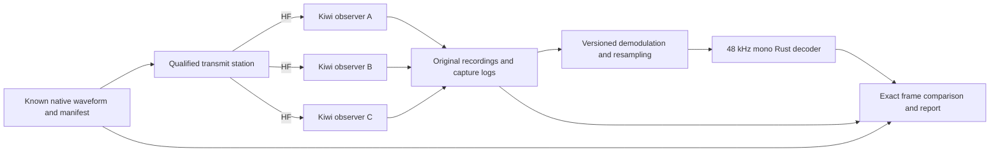
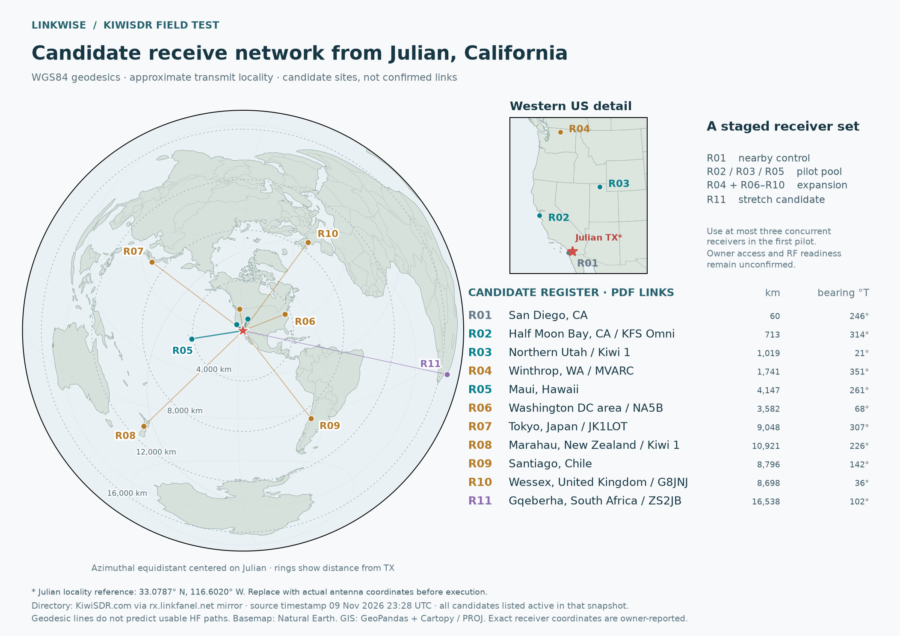

# Linkwise Modem Robustness Test Plan

KiwiSDR field measurements, synthetic channel tests, and stock VARA interoperability

Plan ID: LW-MODEM-KIWI-001  
Revision: 0.11, 18 November 2026

Status: live receive and limited bench evidence recorded in the lab notes. The first CW bench procedure is specified. Confirmatory bench testing, the controlled known-payload RF campaign, and VOACAP evaluation remain unscheduled.

Presentation rule: all figures, tables, and diagrams in the LaTeX/PDF edition
use dedicated landscape pages, scaled within both page dimensions with room for
captions. Keep text readable; restructure a crowded visual rather than relying
on extreme downscaling. This rule also applies to future additions.

## 1. Objective and evidence boundary

Use geographically separated KiwiSDR receivers to capture known Linkwise
transmissions, measure one-way frame recovery under actual HF conditions, and
build a reproducible decoder regression corpus. Add controlled synthetic benches
to isolate the 38 effects in the impairment register, compare stock VARA and Linkwise on
identical inputs, and qualify receiver countermeasures. Test the native modem first;
agent chat, global routing, and message-service behavior are outside this plan.

Test whether point-to-point VOACAP predictions improve the choice of band and
UTC hour for one-way Linkwise BW500 reception. The primary endpoint is the
probability of exact level-2 DATA frame recovery, conditional on confirmed RF
transmission and a usable capture. Assess predicted SNR against measured SNR
as a separate propagation endpoint.

The controlled campaign scores a receiver observation when a known RF
transmission overlaps a valid capture and Linkwise recovers the expected frame
bytes. Exploratory monitoring verified one CRC-valid BW500 level-2 frame from
the full Lake Merwin KiwiSDR recording on 7.105 MHz USB at about 5:25 p.m. PST
on 10 November 2026. Six filter settings reproduced that same frame. The
transmitter-side frame count and payload were unavailable, so this result
establishes receive capability for one observed frame. The controlled trial
will measure recovery rates with a known denominator. Two-way VARA and Winlink
qualification require separate station tests. [Lab notes](../../lab-notes/lab-notes.pdf)

Use three distinct evidence labels:

- **Synthetic:** local waveform generation, impairment injection, and replay.
- **RF observation:** remote recording of a physically transmitted known waveform.
- **Operational link:** a separate, qualified two-station exchange, not established
  by this plan.

## 2. Current implementation and prerequisites

The reference checkout is `57f705fefaeacd74b341bc63ad7f3551698b210b`. Record the actual binary hashes and runtime profile for every campaign. The values below come from the pinned [acquisition implementation](https://github.com/8r4n/linkwise/blob/57f705fefaeacd74b341bc63ad7f3551698b210b/rust/src/modem/bw500/scan.rs). The [modem guide](modem.md) describes the surrounding implementation.

| Baseline item | Frozen setting or scope |
| --- | --- |
| BW500 levels 1 and 3 | Rolling pilot acquisition at 0 and +/-12 Hz. Threshold 0.65. |
| BW500 level 2 | Rolling pilot acquisition at 0, +/-12 Hz, and +/-46.875 Hz at 48 kHz. Threshold 0.20. |
| Input and operating path | WAV replay uses 48 kHz mono PCM16 or float32 with `linkwise decode-wav`. Session tests use the audio-enabled daemon and archived BW500 profile. |
| Level 4 and other bandwidths | Separate implementation and profile coverage. CW-01 qualification covers stock BW500 level-2 DATA ingress. |

Available now:

- Native level 1–3 synthesis and streaming decode; optional level-4 components.
- `linkwise decode-wav` and JSON frame reports containing level, control, payload
  hex, and sample ranges.
- Local [SigPlot demo](modem-demo.md), known waveform examples, and fixture tests.

Needed before an RF campaign:

- A qualified station playback/radio/PTT path, operator, and permitted test
  configuration. The web demo does not key a transmitter, and optional CPAL
  capture is not an integrated operational transmit service.
- A cooperating receiver registry with owner-agreed automated capture windows,
  slot/time limits, settings, and retention/publication terms. Public listing
  alone is not permission for an unattended campaign.
- A pinned KiwiClient revision, capture continuity instrumentation, deterministic
  conversion, manifest generation, and expected-frame comparison tooling.
- A verified physical local transmit monitor recording, plus transmitter start,
  stop, and fault evidence. Generating a WAV alone does not confirm RF emission.

Do not automatically key a radio or occupy public receivers to execute this
written plan. Campaign execution is a subsequent station operation.

## 3. Measurement architecture



Use KiwiClient/`kiwirecorder.py` as the initial capture adapter rather than
browser audio playback or desktop sound recording. Upstream supports audio,
IQ, and waterfall capture, including multiple receivers. IQ Kiwi-WAV recording
can retain GNSS timestamp chunks; validity must be checked before timing use.
The recorder exposes gain/AGC and compression settings and has multiple
resampling paths. Pin the client and record which path actually executes.
Sources: [KiwiClient README](https://github.com/jks-prv/kiwiclient/blob/master/README.md),
[recorder source](https://github.com/jks-prv/kiwiclient/blob/master/kiwirecorder.py).

The publication edition includes five proposed PlantUML views (measurement chain,
physical setup, capture-processing branches, observation scoring, and K0–K5 gates)
and two TikZ schematics (burst timing and signal annotation). Sources are in
`docs/testing/diagrams/` and `docs/testing/figures/`. The signal annotation is a
conceptual illustration, not measured RF data; no receiver locations or global
coverage map are invented before site selection. All views use landscape pages.

These are source capabilities, not evidence that any particular public receiver
currently supports, permits, or has capacity for the selected capture profile.

## 4. Receiver selection and recording profiles

For the first pilot, seek three cooperating receivers: one relatively short
path and two geographically different longer paths where available. At least
one intercontinental observation is a later coverage objective, not a prerequisite
for validating the capture pipeline. Record distance, bearing, UTC window,
antenna information, and path evidence; do not infer availability from distance.

Select receivers using a registry snapshot, then preflight each endpoint.
Do not hard-code an assumed global receiver count. Re-check access rules,
frequency coverage, time limits, slots, clock information, and effective settings
at each session. A failed preflight is an infrastructure exclusion, not an RF
non-detection. Cap the pilot at three simultaneous streams, one slot per receiver,
with an explicit stop deadline; never evade passwords, kicks, or time limits.

**Profile A — initial audio capture:** uncompressed USB audio; no squelch;
noise blanking, noise reduction, de-emphasis and other optional processing off
where supported. Use a fixed documented passband that contains the complete
synthesized waveform, with margin. Fix gain where practical; otherwise record
AGC configuration and label the run accordingly. Verify gain does not clip.

**Profile B — later diagnostic IQ capture:** original complex samples with
recorded center frequency, actual sample rate, IQ convention, and available
GNSS metadata. Offline demodulation must document frequency translation,
sideband, filters, scaling, and delay. Preserve custom timestamp chunks in the
original; do not assume a stereo IQ WAV is directly decodable by Linkwise.

Record the carrier/dial frequency and the waveform's audio-frequency range
separately. Validate the RF-to-audio mapping before judging acquisition; do not
confuse a receiver's passband-center setting with its USB carrier setting.

### 4.1 Julian transmitter and candidate receiver map

The transmitting station will be in **Julian, California**. The map uses
33.0786552° N, 116.6019637° W as an approximate Julian locality reference,
not the actual antenna location. Replace it with the station coordinates
before final path analysis or campaign execution. The locality reference is
[reported from USGS GNIS](https://www.topozone.com/california/san-diego-ca/city/julian/).



In the [interactive PDF map](../../docs/testing/figures/kiwisdr-candidate-map.pdf),
click a receiver ID or its candidate-register name to open its web interface.
The full LaTeX/PDF test plan preserves these links; the PNG preview is static.

Accessibility recheck, **9 November 2026, 23:54 UTC**: all **11/11** candidates
returned HTTP 200 for both their web interface and `/status`; each web response
contained the Kiwi interface and every status response reported `active` with
`offline=no`. The [timestamped per-receiver results](../../docs/testing/data/kiwisdr-access-check.json)
include effective URLs, response codes and returned metadata. Reproduce from the
repository root with `python3 tools/check-kiwisdr-candidates.py`; it exits nonzero
if any candidate fails either check. These bounded HTTP requests open no audio
streams and establish reachability only at the recorded time. Repeat before a
capture session; access rules and audio-slot readiness still apply.

The map is a GIS product generated with GeoPandas, Cartopy and PROJ, using
Natural Earth geographic data. Its global view is WGS84 azimuthal equidistant,
centered on Julian, with a western-US inset. Distances and initial true bearings
are shortest WGS84 ellipsoidal geodesics. Lines show candidate geometry, not
predicted propagation, reliable contact, RF hop counts, or measured coverage.
South Africa is a stretch objective, outside the initial pilot denominator.

Cross-reference snapshot: **9 November 2026, 23:28:19 UTC**, from the public
[KiwiSDR directory mirror](http://rx.linkfanel.net/kiwisdr_com.js). The mirror
header identifies the [official public directory](http://kiwisdr.com/public/)
as its source. That official endpoint still did not respond directly during
this selection. All eleven chosen records were listed active; bounded metadata-only
`/status` requests also returned active status with matching names and coordinates.
No audio connections or receiver reservations were opened. This does not establish
owner permission, future slot availability, clock quality, antenna calibration,
or decodability from Julian. Coordinates remain owner-reported.

The initial pilot pool is **R02 KFS Omni, R03 Northern Utah, and R05 Maui**,
subject to readiness and access arrangements. R01 San Diego is a nearby diagnostic
control; terrain and low-angle/skywave behavior are not assumed. R04 and R06–R10
extend the sampled geography later. Co-located receiver channels and the Utah
IP-address alias are not counted as independent path sites.

| Candidate | Site / experiment role | Distance / initial bearing | Receiver endpoint |
| --- | --- | --- | --- |
| R01 | San Diego, CA / control | 60 km / 246° true | [Open receiver](http://kiwisdr.ka9q.net:8073) |
| R02 | Half Moon Bay, CA / KFS Omni / pilot | 713 km / 314° true | [Open receiver](http://kiwisdr.kfsdr.com:8073) |
| R03 | Northern Utah / Kiwi 1 / pilot | 1,019 km / 21° true | [Open receiver](http://kiwisdr1.sdrutah.org:8073) |
| R04 | Winthrop, WA / MVARC / expanded | 1,741 km / 351° true | [Open receiver](http://mvarc.proxy.kiwisdr.com) |
| R05 | Maui, Hawaii / pilot | 4,147 km / 261° true | [Open receiver](http://22215.proxy.kiwisdr.com) |
| R06 | Washington DC area / NA5B / expanded | 3,582 km / 68° true | [Open receiver](http://www.na5b.com:8073) |
| R07 | Tokyo, Japan / JK1LOT / expanded | 9,048 km / 307° true | [Open receiver](http://jk1lot.ham-radio-op.net:8073) |
| R08 | Marahau, New Zealand / Kiwi 1 / expanded | 10,921 km / 226° true | [Open receiver](http://kiwisdr1.owdjim.gen.nz:8073) |
| R09 | Santiago, Chile / expanded | 8,796 km / 142° true | [Open receiver](http://ce3pbr.proxy.kiwisdr.com) |
| R10 | Wessex, United Kingdom / G8JNJ / expanded | 8,698 km / 36° true | [Open receiver](http://wessex.zapto.org:8073) |
| R11 | Gqeberha, South Africa / ZS2JB / stretch | 16,538 km / 102° true | [Open receiver](http://alg.twrmon.net:8073) |

The [candidate registry](../../docs/testing/data/kiwisdr-candidates.json) retains
stable listing IDs, original names, endpoints, owner-reported coordinates,
listing timestamps, metadata-check evidence, selection rationale, and the source
snapshot SHA-256. The companion CSV, GeoJSON, and GeoPackage can be inspected in
QGIS; see the [GIS provenance guide](../../docs/testing/data/README.md). The full
raw directory snapshot is local build evidence, not a newly asserted worldwide
inventory count. Refresh registry and endpoint checks before execution.

## 5. Stimulus and campaign matrix

Freeze payload bytes, control fields, waveform hashes, and schedule before RF.
Each burst must have a unique expected frame identity. Encode a compact test
sequence in the payload; the manifest holds full experiment metadata so it need
not fit the smallest frame. Include the exact padding/control bytes in the oracle.

Begin with one full DATA frame per burst at levels 1–3. Confirm every stimulus
decodes locally before transmission. Maintain at least two seconds of quiet
guard between bursts and record background before and after the block. Bound
individual test bursts below 20 seconds and preserve enough guard audio to close
the detector's candidate; do not decode an arbitrarily truncated burst.

| Phase | Stimulus / comparison | Repetitions and scope | Purpose |
| --- | --- | --- | --- |
| K0: offline qualification | Known clean waveforms, round-trip conversion, sample gap controls, off-target/background controls | Levels 1–3; no RF or public slots required | Qualify tooling and the exact-byte oracle |
| K1: receiver preflight | Background plus one scheduled known level-1 burst | One cooperating receiver and one valid observation window | Verify tuning, capture continuity, and acquisition scale |
| K2: pilot | Interleaved levels 1–3, fixed station power/configuration | 10 bursts per level, up to three simultaneous receivers | Measure one-way recovery against known transmissions |
| K3: temporal replication | Repeat K2 in distinct contact windows | At least three sessions; record dates and UTC separately | Expose time/path variation without pooling it away |
| K4: decoder comparison | Identical retained K2/K3 captures replayed through baseline and candidate commits | All valid captures; paired comparison | Isolate software changes from HF variation |
| K5: diagnostic extension | One variable at a time: bounded offset, power setting, AGC profile, or optional level 4 | Separate predeclared blocks after K0–K2 | Characterize specific failure modes |

A complete K2 block contains 30 transmitted bursts and up to 90 receiver/burst
observations, not 90 independent transmissions. K3 repeats that block across
sessions. Randomize or balance level order within each block and preserve the
ordering seed. Final block length and airtime are computed from actual waveform
durations before scheduling; abort if they exceed station or receiver limits.

Do not vary power, passband, gain, level, and software simultaneously and then
attribute the result to one variable. Native transmit-version A/B comparisons
need interleaved, balanced RF trials; unlike decoder replay, different RF
transmissions do not experience identical channels.

### 5.1 VOACAP pilot and multi-region campaign

1. Extend K2/K3 from one transmitter to a registry of 4–6 cooperating KiwiSDRs,
   using up to three simultaneous receivers per block and rotating by a fixed
   schedule. Reuse the 30-burst stimulus design with unique burst IDs across
   blocks. Hold power, antenna and decoder configuration fixed. Score level 2
   as the primary endpoint and levels 1 and 3 as secondary endpoints. Repeat
   blocks on different UTC dates in hours with both high and low predicted SNR.
2. Use pilot estimates of availability, decode rates and within-day/path
   correlation to size the evaluation for precision on the difference in Brier
   score against the baseline. Freeze the precision target, sample size and
   stopping rule before evaluation. Start planning with 3–5 transmitters,
   12–20 cooperating receivers and two bands over 4–6 weeks. Stratify by
   distance, latitude and day/night/terminator geometry, including
   intercontinental paths. Repeat each selected path, band and UTC-hour cell
   on multiple dates within a month. Use the resulting coverage to bound any
   generalization beyond the participating sites and sampled months.
3. Use local VOACAPL. Verify its parser and UTC-hour mapping against a checked
   point-to-point case. Freeze input decks, raw outputs and schedule before
   recording. Record the engine and coefficient revisions, month, smoothed
   sunspot number and source, station coordinates and path choice, channel
   frequency and USB dial offset, logged transmitter output and feedline loss,
   antenna patterns and azimuths, receiver noise assumptions and required SNR.
   Flag estimated inputs and freeze sensitivity cases for uncertain receive
   antennas or noise. Record departures from the planned configuration.
   See the [Linkwise propagation toolbox](../../reference/propagation-toolbox.md).

Include background-only windows to check false detections. Log opportunistic
VarAC activity separately as observed examples with unknown transmission
counts. A stock VARA comparison can use its own interleaved matched-power,
matched-bandwidth and matched-level blocks with a byte oracle for each source.
That comparison is optional and separate from the primary Linkwise endpoint.

## 6. Per-session execution procedure

1. Assign experiment, session, burst, and receiver IDs; freeze source commits,
   configuration, expected bytes, hashes, and the scheduled listening window.
2. Run existing native tests and decode every source WAV. Pin the external profile
   if level 4 is included. Preserve machine-readable outputs.
3. Preflight receiver access and effective settings. Start capture at least
   30 seconds before the first scheduled transmission, without squelch. Confirm
   samples arrive and establish a noise/background interval.
4. Confirm the qualified station configuration and local monitor. Transmit the
   bounded schedule through the station's approved execution path, retaining
   actual playback/RF evidence and recording aborted or partial transmissions.
5. Continue capture at least 30 seconds after the last burst; terminate and
   release receiver slots at the registered deadline.
6. Hash originals, validate continuity/settings, and classify each observation
   before looking at decoder success. Preserve all exclusions with reasons.
7. Derive 48 kHz mono analysis WAVs with a pinned high-quality resampler and,
   for IQ, a pinned demodulation pipeline. Record delay and original sample/time
   mapping. Keep each eligible continuous interval intact, including background and
   guards. Split at actual discontinuities and retain their source ranges.
8. Decode both baseline and candidate versions and compare exact frame bytes.
   Generate the report, archive required artifacts, and retain failures as well
   as successful examples. Publish only material covered by the capture terms.

No experiment starts solely because a model predicts an opening. The station
execution path retains local authority, timing, and stop conditions.

## 7. Capture validity and normalization

Assign validity independently for decode, amplitude/SNR, and precise timing.
For example, a contiguous audio capture with uncertain clock can support frame
recovery while remaining ineligible for propagation timing measurements.

- Sequence discontinuities, reconnects, missing samples, unexplained rate changes,
  and truncated windows make affected intervals decode-ineligible unless complete
  unaffected bursts can be isolated with explicit provenance. Do not interpolate
  missing signal samples and count the result as a valid RF observation.
- Receiver unavailable/busy, permission denial, client faults, and inability to
  verify required settings are infrastructure outcomes. A valid continuous
  recording with no recovered signal remains an RF/decode outcome.
- Preserve overloaded/clipped captures and their flags. Exclude them from clean
  sensitivity claims under predeclared rules; report their prevalence separately.
- Never use internet packet arrival time as RF arrival time. GNSS validity,
  sample continuity, and calibration determine timing eligibility. This pilot
  does not attempt TDoA or absolute propagation-delay measurement.

Run two explicitly different decoder profiles on each eligible capture:

1. **As received:** fixed conversion scale; no per-burst amplitude normalization,
   denoising, carrier correction, or timing correction beyond the declared import.
   This exposes acquisition behavior on the original capture scale.
2. **Diagnostic:** optional documented gain, frequency, or sample-rate correction.
   Save the transform and never mix these results into the as-received score.

Converting an actual lower-rate recording to 48 kHz changes representation; it
does not restore missing bandwidth or eliminate oscillator/sample-clock errors.

### Regression replays before the next RF session

Build Linkwise once and replay each full 48 kHz mono input using the existing
`linkwise decode-wav` command. Preserve the IQ demodulation settings and
resample at the recorded input rate before importing IQ. The decoder finds
level-1--3 boundaries and its own frequency hypotheses. The regression
supplies no frame windows or manual frequency correction.

- **Lake Merwin live capture.** Expect exactly one level-2 frame from the full
  7.105 MHz USB derivative. Check the 23-byte body hash in the evidence record.
  The IQ center is 7.1065 MHz. Both 330 Hz and 1200 Hz baseband low-pass
  derivatives are verified profiles.
- **Published off-air exchange.** Replay the full slot 13 recording. Require
  three frames in order, levels 2, 3, 2, with the recorded body hashes.
- **Kiwi noise controls.** Require byte-exact recovery of each +6 dB stock
  level-1 and level-2 injection. Require zero frames from the unmodified
  Maui noise capture.

Compare SHA-256 over decoded payload-field bytes followed by the one control
byte. Check count and order as well as hashes. Report lost or added frames,
duplicated frames, and truncated energy candidates. These are regression
cases, separate from the frozen holdout and the live recovery denominator.
The archived automatic acquisition JSON and preprocessing evidence are in the
local follow-up directory listed in the lab notes.


## 8. Metrics and scoring

| Metric | Definition and denominator | Availability |
| --- | --- | --- |
| Capture availability | Complete eligible receiver/burst windows / planned windows | New capture manifest and validity checker |
| Exact frame recovery | Unique exact expected frames / expected frames confirmed transmitted within decode-eligible windows | Current decoder output plus new comparator |
| Acquisition yield | Expected bursts associated with receiver candidates / eligible confirmed transmitted bursts | Requires additional candidate/frame association reporting |
| Nonmatching CRC-valid output | Valid decoded frames conflicting with the expected identity/bytes | Comparator; retain sample positions and investigate every case |
| Background false detections | CRC-valid frames during confirmed no-test-transmission intervals, per recorded hour | Current decoder plus background labels; unrelated traffic is classified separately |
| Offline decode cost | Wall/CPU time and peak memory per audio duration, fixed machine/configuration | New harness; exclude RF pacing/network wait |
| Frequency offset / fading | Estimated against the known signal, with method and uncertainty | Later instrumentation; not currently exported as qualified metrics |
| SNR | Declared in-band signal/noise estimate with bandwidth, method, and uncertainty | Separate estimator; not a raw S-meter comparison |

Report the number of confirmed complete transmissions, eligible captured
observations, and unique exact recoveries separately.

Missing expected frames count as failures when capture and transmission evidence
are valid, even if acquisition finds nothing. Count a repeated decoded frame
only once for recovery; separately count duplicates. A partial transmission is
reported as such, not included as an expected complete frame. Retain orphan
frames and unknown associations rather than silently forcing matches.

Do not claim BER from CRC-valid frames alone. Failed frames do not expose all
bit errors through the existing API. Do not label unique recovered bytes per
transmitted airtime as ARQ goodput or end-to-end message throughput.

For SNR, use a declared signal band and comparable noise intervals with the same
receiver settings and bandwidth. Where justified, estimate signal power as
on-burst power minus estimated noise power in linear units. If interference,
AGC changes, nonstationary noise, or nonpositive subtraction invalidate the
estimate, report SNR unknown. Display SNR bandwidth in every comparison. Do not
infer calibrated path loss from different receivers' S-meter readings.

Report per receiver, level, band, UTC session, capture profile, and software
revision. Include raw counts and paired baseline/candidate changes. Repeated
frames on one fading path and simultaneous observations of one transmission
are correlated; use session/contact-block summaries or a justified clustered
interval method. A pilot's high score is not a global reliability estimate.

### 8.1 Comparing predictions and observations

Join each scheduled burst/receiver pair to a frozen prediction by transmitter,
receiver, modeled frequency, UTC month and UTC hour. Record the actual burst
timestamp and flag out-of-window transmissions. Every planned pair must have
one disposition. Confirmed RF plus eligible capture yields an exact decode or
a valid miss. Unusable capture and unconfirmed or partial transmission stay
outside the decode denominator. Report capture availability and its reasons by
path, time and predicted SNR so coverage gaps are visible.

VOACAP predicts a distribution across days at a given hour of a month. Save
median SNR and the lower and upper decile departures in dB-Hz, plus REL and
its required SNR when computed. Compare the median prediction with medians of
daily observed SNR summaries for the same path, band, month and UTC hour.
Report signed error, absolute error, and the number of contributing days.
Measure on scheduled burst windows independently of decoder output using
matched background windows. Convert valid in-band SNR to dB-Hz by adding
10 log10 of the effective noise bandwidth in Hz. Prefer fixed gain or
calibrated IQ. Record defensible upper limits for signals below the measurement
floor, and mark SNR unavailable when interference or gain changes invalidate
it. Report censoring and missingness, and use a censored estimate or bounds
where the data cannot resolve a median. Include these windows in decode scoring
when the capture is decode-eligible. [VOACAP output definitions](https://www.voacap.com/2023/voacap-windows-output.html)

Measure the level-2 decode-versus-SNR curve in the bench with the frozen
decoder and capture filter. Include representative HF fading and delay spread
profiles. Use the median VOACAP SNR as a ranking score and, as a physical
baseline, average the bench curve over the predicted SNR distribution using
a declared approximation to its deciles. A threshold-based REL comparison
may use a bench-derived required SNR fixed in advance. REL gives the modeled
frequency of exceeding that threshold across days. Decode probabilities and
their calibration must be evaluated against observed bursts.
[VOACAP reliability calculation](https://www.voacap.com/2023/understanding/rel.html)

Fit a band-and-UTC-hour decode baseline and, if used, a VOACAP calibration
model on development data. Freeze both before evaluation. Hold out entire UTC
dates for the primary comparison and entire receivers for a separate
transfer check. Report paired Brier score differences and calibration by
predicted probability. Report how often the higher-scored band or hour has
higher observed recovery within the same path, using prespecified comparisons
and a declared tie rule. Estimate uncertainty with a method that accounts for
both UTC-date and path clustering. Summarize receiver availability and results
by path length, latitude, daylight and noise floor with raw denominators.

## 9. Acceptance and progression gates

These are proposed experimental gates, not achieved modem service levels.
Pre-register any change before collecting the evaluation dataset.

- **K0 tooling gate:** all clean level 1–3 fixtures survive supported import and
  conversion with identical expected bytes; repeated replay produces identical
  frame results; seeded capture gaps are identified and not silently repaired;
  metadata/hashes and original-to-derived sample mapping are complete.
  The full-recording regression cases in section 7 must also meet their exact
  frame-count, order, and hash expectations.
- **K1 capture gate:** one correctly tuned, contiguous observation includes its
  full known RF burst and guards, with local transmission confirmation and
  usable settings evidence. A failed decode can still be a valid diagnostic
  observation; it is not a receiver preflight failure solely for decoding poorly.
- **K2 pilot completion:** all planned observations have an outcome, exclusion
  reason, or explicit missing status; at least one exact RF-observed frame is
  needed before claiming remote RF decoding demonstrated. Missing that result
  triggers diagnosis, not removal of failed windows from the denominator.
- **K3 replication:** collect three distinct session blocks with complete
  provenance before describing repeatable behavior for the sampled paths. No
  universal minimum frame-recovery percentage is asserted without a defined
  channel and station operating envelope.
- **K4 release comparison:** on a frozen holdout corpus, no new exact-byte
  mismatch, unreported discontinuity, crash, or out-of-budget resource use.
  Report all gained and lost frames. A recovery-loss tradeoff needs an explicit
  profile-specific decision; aggregate improvement cannot hide a lost case.
- **K5 extension:** level 4, DSP corrections, and transmit comparisons remain
  separately labeled. Never promote synthetic-only evidence to RF or stock-peer
  qualification.

If sensitivity targets are desired, define them after the pilot using a separate
training corpus, then freeze thresholds and test on held-out captures. Do not
select the easiest receivers or adjust gain/thresholds on evaluation recordings
and report the outcome as unbiased performance.

- **VOACAP pilot exit:** every planned observation reconciles to its terminal
  status and frozen path-hour prediction, and the SNR estimator passes replay
  controls for signal, noise-only and gain changes. Inspect coverage, censored
  SNR and dependence before freezing the expansion design. Campaign progression
  depends on measurement readiness and achievable statistical precision.
- **VOACAP evaluation:** keep the held-out schedule and scoring independent of
  model fitting. Claim predictive improvement for the sampled settings only
  if the prespecified interval for the paired Brier score difference favors
  the VOACAP model over the band-and-hour baseline. Report inconclusive
  results and sparse strata with their uncertainty.

## 10. Evidence package and report

Store large originals outside the source repository until storage and
redistribution terms are settled. Suggested logical structure:

```text
experiment-id/
  plan.json                   # revision, matrix, limits, selection rules
  predictions/                # frozen VOACAPL inputs, raw output and path-hour table
  transmit/                   # expected frames, waveform, local monitor, logs
  receiver-id/session-id/
    capture.json              # effective settings, continuity, timing validity
    original/                 # immutable audio/IQ and sidecar logs
    derived/                  # 48 kHz WAVs and exact conversion recipe
    results/baseline.json
    results/candidate.json
  observations.csv            # every planned burst/receiver pair and prediction ID
  report.json                 # denominators, exclusions, comparisons, uncertainty
  report.md                   # interpretation and bounded claims
```

Each manifest needs commit IDs, dependency/profile versions, SHA-256 hashes,
planned and actual UTC times with clock confidence, transmitter configuration,
receiver endpoint/location provenance, mode/passband/gain settings, source sample
rate, sequence-gap ranges, processing transforms, expected-frame IDs/bytes,
transmission evidence, observation eligibility, and terminal reasons. Keep
credentials outside exported manifests.

The report must show infrastructure availability beside RF recovery, list every
invalid/missing observation, distinguish raw and corrected results, and retain
receiver/path/session strata. Include waterfall/spectrum views as explanation,
not as substitutes for exact-byte results.

Publish a path-by-hour map showing predicted SNR, observed exact recovery and
capture availability in separate panels. Pair it with calibration and SNR
residual plots, counts of unique dates and paths, and intervals for the held-out
comparison. Identify the frozen version IDs and archive the analysis script,
split membership and exclusions so the figures can be regenerated.

## 11. Initial implementation backlog and commands

1. Use `tools/kiwisdr-bench.py prepare` and `verify` for 30 uniquely identified
   native source bursts and exact local replay. Qualify the remaining import and
   continuity tooling before treating K0 as complete.
2. The versioned capture launcher now bounds a pinned recorder invocation;
   qualify it with cooperating receivers and add verified continuity metadata.
   Preserve originals at their received rate. See the exact sequence in section 14.
3. Add deterministic audio/IQ import and a manifest validator, including gap and
   sample-position handling. Neither component currently exists in Linkwise.
4. Add a comparator/report harness around the existing Rust WAV CLI. Add missing
   acquisition/soft-decision metrics only as separately tested instrumentation.
5. Complete K0 before arranging K1 receiver access and a qualified RF transmission.
6. Qualify a pinned VOACAPL run and UTC-hour parser against a reference case.
   Build the planned-observation join, SNR estimator and held-out analysis
   before running the VOACAP pilot extension.

Existing commands from the repository root:

```sh
# Existing external fixture/profile validation; downloads pinned inputs.
python3 tools/test-modem.py

# Decode an already converted 48 kHz mono analysis WAV.
cargo run --locked --manifest-path rust/Cargo.toml --bin linkwise -- \
  decode-wav /path/to/derived-48k-mono.wav
```

For optional level-4 replay, set `LINKWISE_BW500_PROFILE` to the verified profile
as described in the modem guide. Capture wrappers, comparison reports, RF
playback, and global receiver selection are backlog items, not commands supplied
by this draft.

## 12. Source and inventory status

Primary technical sources reviewed on 9 November 2026:

- [KiwiClient README](https://github.com/jks-prv/kiwiclient/blob/master/README.md):
  stream/recording capabilities, resampling, and GNSS-tagged IQ format.
- [Kiwi recorder implementation](https://github.com/jks-prv/kiwiclient/blob/master/kiwirecorder.py):
  effective gain/AGC, compression, resampling, and sample-writing behavior.
- [Linkwise modem implementation status](modem.md) and the current Rust WAV CLI.

Propagation sources reviewed on 17 November 2026 include the
[VOACAP output definitions](https://www.voacap.com/2023/voacap-windows-output.html),
[circuit reliability calculation](https://www.voacap.com/2023/understanding/rel.html)
and [VOACAPL source](https://github.com/jawatson/voacapl).

The source links follow upstream `master`; resolve and record an immutable
revision before implementing the capture adapter. The supplied
[public directory](http://kiwisdr.com/public/) failed to load directly. Section 4.1
now records a dated mirror-derived shortlist cross-checked against receiver
metadata; recording access and campaign readiness remain unconfirmed.

## 13. Selected template and tailoring

Use the repository's [engineering verification Test Plan template](https://github.com/8r4n/acq-latex-templates/blob/fef160e37542fd7bc8e62de81404a83b8634a396/templates/engineering/verification/test-plan/main.tex)
as the structural basis for this plan. Inspected source revision:
`fef160e37542fd7bc8e62de81404a83b8634a396`, 9 November 2026.
The template identifies DI-NDTI-80808 as its source; this draft does not claim
independent verification of that document or contractual compliance.

This is a system/modem experiment involving software, an RF transmit chain,
remote instruments, capture integrity, and data analysis. The broader test-plan
template fits better than the [Software Test Plan](https://github.com/8r4n/acq-latex-templates/blob/fef160e37542fd7bc8e62de81404a83b8634a396/templates/engineering/software/stp/main.tex),
which is oriented toward software qualification against software requirements.
A later software qualification plan can cover the decoder/import/comparator
independently without treating this exploratory RF pilot as formal qualification.

Retain the template's engineering organization and replace acquisition-program
metadata with Linkwise document ID, revision, author/maintainer, test lead,
configuration baseline, and review status. Do not copy placeholder signatures,
agency roles, acquisition milestones, or default distribution markings into the
project. This Markdown draft remains the maintained content source. The generated,
template-structured LaTeX edition is
[kiwisdr-modem-test-plan.tex](../../docs/testing/kiwisdr-modem-test-plan.tex);
run `python3 tools/build-kiwisdr-test-plan.py --build` from the repository root.

| Selected template section | Content in this draft / tailoring |
| --- | --- |
| Scope | Sections 1–2: objectives, boundaries, implementation baseline |
| Referenced Documents | Section 12 and the immutable template reference here; freeze all execution dependencies before a campaign |
| Test Items | Sections 2, 5, and 10: transmitter waveforms, decoder commits, external profile, capture/conversion pipeline, as-tested manifests |
| Test Approach | Sections 3–9 plus the objective records below |
| Resources, Facilities, and Equipment | Section 4 and resource/status table below |
| Safety | Station readiness, abort/restore rules below; campaign-specific hazards remain to be assessed before RF |
| Schedule | K0–K5 dependency sequence; calendar windows remain unscheduled until resources and entry criteria are confirmed |
| Data Management and Reporting | Sections 8 and 10: immutable originals, derived artifacts, scoring, exclusions, and final report |
| Submission-readiness appendix | Use the readiness review below, adapted to a project experiment rather than a contractual submission |

### 13.1 Objective records and traceability

These IDs are local experimental objectives, not inherited software requirements
or the agent-chat requirements in the whitepaper. Method codes: T = test,
A = analysis, I = inspection. Gate IDs retain the definitions in section 9.

| Objective | Method / phase | Entry and exit criterion | Required evidence |
| --- | --- | --- | --- |
| KW-OBJ-01: trustworthy acquisition and import | I/T, K0–K1 | Enter with pinned tooling and known fixtures; exit with K0 tooling criteria met and K1 capture validity established | Hashes, versions, effective settings, continuity results, conversion/sample mapping |
| KW-OBJ-02: exact one-way RF frame recovery | T/A, K2 | Enter after tooling/capture readiness; complete the planned matrix and report every observation; claim RF recovery only after an exact observed frame | Transmit confirmation, expected bytes, capture eligibility, exact matches/misses and exclusions |
| KW-OBJ-03: sampled path/time repeatability | T/A, K3 | Enter with K2 evidence; exit with three distinct complete session blocks | Receiver/path/session-stratified counts and uncertainty; no global reliability inference |
| KW-OBJ-04: decoder regression comparison | T/A, K4 | Enter with a frozen holdout corpus and fixed machine/profile; apply K4 release criteria | Paired gained/lost frames, mismatches, failures, resource costs, and disposition |
| KW-OBJ-05: diagnostic characterization | T/A, K5 | Enter after K0–K2 with a predeclared single-variable matrix; complete it or record why it stopped | Raw/corrected separation, estimator validity, all variable settings and unresolved limits |
| KW-OBJ-06: VOACAP prediction skill | T/A, K2–K3 extension | Freeze predictions for the pilot. Qualify the estimator and size the expansion before collecting held-out data | SNR error, exact recovery, availability, and paired held-out scores with clustered intervals |
| KW-OBJ-07: CW qualification | T/A, CW-01 rev. 1.0 | Calibrate routing and verify level 2 in both roles. Apply all role, condition, negative exposure and activation gates. | Paired binary session outcomes, fallback traces, stock replay and incorrect-output records |
| KW-OBJ-08: calibrated sensitivity | I/T/A, F.1487 reference profile | Measure profile against declared tolerances. Freeze a recovery curve design before comparing modems. | Per-path traces, calibration record, in-band SNR and exact recovery intervals |

A test result references the objective, phase/gate, plan revision, procedure
revision, configuration manifest, and raw/reduced evidence. Deviations receive
unique IDs, rationale, decision owner, and impact on validity; never discard a
failed observation merely because a later repeat succeeds.

### 13.2 Resources, readiness, and restoration

| Resource / role | Pilot quantity | Required responsibility / evidence | Current status |
| --- | ---: | --- | --- |
| Qualified transmit station and operator | 1 | Approved configuration, playback/RF monitor, PTT release and stop procedure | Not assigned or qualified under this plan |
| Cooperating Kiwi receivers / owners | Up to 3 | Agreed windows, access/automation limits, effective settings and capture terms | Shortlisted in section 4.1; windows/access unconfirmed |
| Test lead | 1 role | Freeze matrix, review readiness, record deviations and terminal outcomes | Not assigned |
| Capture/analysis operator | 1 role | Bounded recording, immutable artifacts, conversion and scoring | Not assigned; may share personnel with test lead |
| Analysis host and storage | 1 environment | Versioned dependencies, adequate disk/network capacity, measured resource limits | Execution baseline not frozen |
| Reference/calibration evidence | Per measurement | Clock/gain/frequency confidence appropriate to claimed metric | To be established; uncalibrated metrics stay excluded/unknown |

The readiness review must establish all of the following before a scheduled RF
block: K0 tooling complete; test lead/operator assigned; station configuration
and local monitor qualified; receiver windows confirmed; expected-frame matrix
and airtime limits frozen; storage capacity checked; stop/restoration actions
executable; and capture terms and measurement limitations recorded. The review
is a campaign preparation step, not a new per-message approval mechanism.

Abort the affected block on station safety/PTT faults, exceeded airtime or
capture deadline, receiver-owner termination, or storage/continuity failures
that prevent valid observation. The station's local stop/release procedure
remains authoritative. Record partial transmissions, stop capture jobs, release
receiver slots, preserve logs, and verify station restoration. Decide whether a
fresh block is warranted only after documenting the cause and revised readiness;
do not silently extend receiver sessions or repeat RF transmissions.

For execution, develop a separately revisioned procedure using the repository's
[Test Procedure template](https://github.com/8r4n/acq-latex-templates/blob/fef160e37542fd7bc8e62de81404a83b8634a396/templates/engineering/verification/test-procedure/main.tex),
with step, action, expected result, actual result, and disposition fields. Report
observations through the [Test Report template](https://github.com/8r4n/acq-latex-templates/blob/fef160e37542fd7bc8e62de81404a83b8634a396/templates/engineering/verification/test-report/main.tex),
including as-tested configuration, deviations, anomalies, and evidence-backed
conclusions. These companion deliverables are planned, not yet executable or
completed records. A program-level TEMP is unnecessary for this bounded pilot;
its broader strategy role remains with the whitepaper and implementation roadmap.

## 14. Exact sequence, commands, and expected results

These are the as-planned steps, not completed test records. Run commands from
the repository root in a POSIX shell. Stop on any unexpected exit status; retain
stdout, stderr, actual result, UTC observation time, operator, and disposition
against the step ID. Successful process exit alone is not RF or delivery success.
All command tables are landscape in the publication edition.

**Execution boundary:** A and B are local/file operations. C installs and checks a
pinned recorder without opening a receiver. D/E require an agreed receiver window,
qualified station procedure, and completed readiness review; they have not been
executed. F requires valid acquired evidence. No command below keys a transmitter.

The test lead must provide actual antenna coordinates, permitted frequency,
receiver passband/gain, access windows, and calibrated station procedure before
RF. Commands with shell variables are exact invocations after those values are
reviewed. Empty or unreviewed parameters are a stop condition, not permission to
substitute a convenient frequency. Hardware-specific playback/PTT commands cannot
be prescribed until that station interface is qualified.

### 14.1 A — Freeze a local baseline

Use a new experiment directory for each attempt; do not reuse the example after
it contains evidence. Terminal A is reserved for the local demo service. Terminal
B runs the remaining shell commands and keeps the exported variables.

| Baseline step | Exact command / action | Expected result | Evidence / disposition |
| --- | --- | --- | --- |
| A01 | `export KIWI_RUN_DIR="$PWD/docs/build/kiwi-run-001"` | Absolute new experiment location selected. Change the suffix for another run. | Record selected path; no existing evidence overwritten. |
| A02 | `mkdir "$KIWI_RUN_DIR"` | Exit 0; directory created. Existing directory must cause a stop. | New empty workspace. |
| A03 | `git rev-parse HEAD > "$KIWI_RUN_DIR/linkwise-commit.txt"` | One full commit ID written. Also retain the working-tree state in A04. | Source identity, not proof of a clean tree. |
| A04 | `git status --porcelain=v1 > "$KIWI_RUN_DIR/working-tree.txt"` | File records every local change. A qualification baseline requires a reviewed committed state or archived source diff. | Do not silently call an edited tree the named commit. |
| A05 | `cargo build --locked --manifest-path rust/Cargo.toml --features demo --bins` | Exit 0; `rust/target/debug/linkwise` and `modem-demo` available. | Build output; record Rust/toolchain versions. |
| A06 | `python3 tools/test-modem.py` | Pinned reference/profile hashes match and native tests pass; exit 0. Downloads may occur. | Full test log; does not establish RF interoperability. |

### 14.2 B — Prepare and verify the 30-burst oracle

| Stimulus step | Exact command / action | Expected result | Evidence / disposition |
| --- | --- | --- | --- |
| B01 | Terminal A: `rust/target/debug/modem-demo --port 8789` | Binds localhost and prints its URL. Keep running through B03. A port conflict is a stop, not a reason to terminate an unknown process. | Local service only; no radio or Kiwi stream. |
| B02 | Terminal B: `curl --fail --max-time 10 http://127.0.0.1:8789/api/config --output "$KIWI_RUN_DIR/demo-config.json"` | Exit 0; JSON advertises native levels 1–3. | Retain configuration; inspect available levels. |
| B03 | `python3 tools/kiwisdr-bench.py prepare --url http://127.0.0.1:8789 --output "$KIWI_RUN_DIR/stimuli"` | Creates 30 mono 48 kHz PCM16 WAVs, `manifest.json`, and `schedule.json`. IDs B001–B030; payloads K00000001–K00000030; L1,L2,L3 repeated ten times; one full frame each. | Each source was byte-verified by Rust before export. No RF emitted. Nonempty output directory is rejected. |
| B04 | `python3 tools/kiwisdr-bench.py verify --manifest "$KIWI_RUN_DIR/stimuli/manifest.json" --decoder rust/target/debug/linkwise --output "$KIWI_RUN_DIR/local-verification.json"` | Exit 0 and summary `passed: true`, `files: 30`, `verified_frames: 30`. Every WAV hash/header and decoded level/control/payload must match its oracle. | Retain the full per-file decoder report. Any mismatch stops the campaign. |

| Oracle review step | Exact command / action | Expected result | Evidence / disposition |
| --- | --- | --- | --- |
| B05 | `python3 -m json.tool "$KIWI_RUN_DIR/stimuli/schedule.json"` | Planned pre/post-roll are 30 s each; minimum interburst guard 2 s; durations are derived from actual WAV samples; capture duration is finite. | This is a proposed schedule, not actual RF timing. |
| B06 | `shasum -a 256 "$KIWI_RUN_DIR/stimuli/manifest.json" "$KIWI_RUN_DIR/stimuli/schedule.json" > "$KIWI_RUN_DIR/stimulus-hashes.txt"` | Two SHA-256 records written for the frozen oracle/schedule. | Preserve these alongside per-WAV hashes in the manifest. |
| B07 | Terminal A: press Ctrl+C. | The owned local service stops; exported evidence remains. | No receiver slots or PTT are involved. |
| B08 | Readiness review: inspect gap detection, import conversion tests, and resource evidence required by K0. | Mark K0 complete only when all section 9 conditions are evidenced. B04 alone covers clean source replay, not Kiwi continuity or resampling qualification. | STOP if missing; no RF stage may inherit a false K0 pass. |

### 14.3 C — Provision the reviewed capture client

The recorder is pinned to `4eb733e6b6147f7fbeb97ced64cdac029b202d18`.
Command flags were checked against that revision's option declarations;
[the source-check record](../../docs/testing/data/kiwiclient-command-reference.json)
contains the URL, source hash and reviewed flags. This is source inspection,
not a claim of a successful live recorder run. A missing dependency is resolved
before capture; never install or change a decoder dependency mid-evaluation.

| Client step | Exact command / action | Expected result | Evidence / disposition |
| --- | --- | --- | --- |
| C01 | `export KIWI_CLIENT_DIR="$KIWI_RUN_DIR/kiwiclient"` | New checkout path below the experiment directory. | Do not point at an unreviewed working checkout. |
| C02 | `git clone --no-checkout https://github.com/jks-prv/kiwiclient.git "$KIWI_CLIENT_DIR"` | Repository fetched; no receiver connection. | Retain clone errors if acquisition fails. |
| C03 | `git -C "$KIWI_CLIENT_DIR" checkout --detach 4eb733e6b6147f7fbeb97ced64cdac029b202d18` | Exact reviewed revision checked out. | Capture launcher independently checks HEAD. |
| C04 | `python3 -m venv "$KIWI_RUN_DIR/capture-venv"` | Isolated capture environment created. | Record interpreter version. |

| Environment step | Exact command / action | Expected result | Evidence / disposition |
| --- | --- | --- | --- |
| C05 | `export KIWI_PY="$KIWI_RUN_DIR/capture-venv/bin/python"` | Capture interpreter is explicitly selected. | No dependence on an activated shell environment. |
| C06 | `"$KIWI_PY" -m pip install numpy pypng` | Dependencies install successfully. These packages must be frozen and reviewed in C07 before testing. | Installation log; this does not qualify resampling. |
| C07 | `"$KIWI_PY" -m pip freeze > "$KIWI_RUN_DIR/capture-dependencies.txt"` | Actual installed versions recorded. Freeze this environment for the campaign. | Archive with Python version and platform. |
| C08 | `"$KIWI_PY" "$KIWI_CLIENT_DIR/kiwirecorder.py" --help > "$KIWI_RUN_DIR/recorder-help.txt"` | Exit 0; reviewed flags present; no receiver stream opened. | Compare flags with pinned source record. |

### 14.4 D — Configure and preflight one receiver

For K1, use a single cooperating candidate. For K2, repeat D and E01 in a
separate shell for each agreed receiver (maximum three). R02's endpoint is an
example from the reviewed registry, not a booking. Create separately reviewed
profiles for R03 and R05 rather than silently reusing R02's host/gain values.

| Profile step | Exact command / action | Expected result | Evidence / disposition |
| --- | --- | --- | --- |
| D01 | `cp docs/testing/procedures/capture-profile.env.example "$KIWI_RUN_DIR/capture-profile.env"` | Profile template copied into the new run. | Original template stays unchanged. |
| D02 | MANUAL: fill the empty profile fields from the approved station/receiver configuration, then run `. "$KIWI_RUN_DIR/capture-profile.env"` | Node, host/port, USB carrier kHz, passband edges Hz, fixed gain and capture duration are explicitly reviewed. K1 duration example is 120 s, subject to the agreed window. | Empty settings must stop capture. Do not guess a transmit frequency. |
| D03 | `curl --fail --max-time 10 "http://$KIWI_HOST:$KIWI_PORT/status" --output "$KIWI_RUN_DIR/$KIWI_NODE_ID-status.txt"` | Metadata request returns the expected receiver name/coordinates and current status. | A listing, HTTP 200 or spare slot is not owner consent. No audio stream yet. |
| D04 | MANUAL: review access agreement, station procedure, antenna coordinates, local monitor, complete K0 evidence, and stop/restoration rules. | Readiness disposition recorded before E01. | BLOCKED until the actual playback/PTT procedure and RF configuration are qualified. |
| D05 | For K2, set `export KIWI_CAPTURE_S="$(python3 -c 'import json,os; print(json.load(open(os.environ["KIWI_RUN_DIR"]+"/stimuli/schedule.json"))["capture_seconds"])')"` | Duration comes from the actual prepared 30-burst schedule and fits the agreed receiver/station window. | This step precedes capture; do not extend a live session silently. |

### 14.5 E — Capture and execute the scheduled block

| Capture step | Exact command / action | Expected result | Evidence / disposition |
| --- | --- | --- | --- |
| E01 | `sh docs/testing/procedures/capture-audio.sh` | One uncompressed USB audio recording is saved at its received sample rate, with `capture.log`. No squelch, noise blanker, resampling, exemption password or unlimited retry option is requested. | Read the actual output filename from the log. The launcher refuses an existing capture directory or wrong client commit. |
| E02 | MANUAL: after confirming actual audio capture, wait at least 30 s before the first planned burst. | A continuous pre-roll exists; actual clock/start evidence is logged. | Network request/packet arrival time is not an RF timestamp. |
| E03 | MANUAL, station-specific: execute the separately qualified playback/PTT procedure for the frozen WAVs and schedule. K1 sends only B001; K2 sends B001–B030 in order. | Local monitor confirms each actual transmission, level, ID and time; at least 2 s quiet between bursts. | No universal station command exists in Linkwise yet. Insert the real command/procedure revision before execution; do not transmit until then. |
| E04 | MANUAL: preserve at least 30 s post-roll after the last actual burst. | Full last burst and trailing guards recorded before capture stops. | Record early/partial termination instead of claiming full observation. |

Run E01 in the capture terminal while the station operator performs E02–E04
concurrently using the separate qualified station console. Do not wait for E01
to finish before beginning the scheduled RF block. Normal return is checked
after post-roll, before preservation and restoration.

The versioned launcher contains the exact `kiwirecorder.py` command: USB mode,
explicit `-L`, `-H` and `-g`, `--ncomp`, `--tlimit`, five-second connect/busy
timeouts and one retry each. It applies an independent subprocess wall limit of
capture duration plus 30 s. Normal completion is required; timeout/nonzero exit
marks affected data ineligible pending inspection. It opens no transmitter.
Inspect [the capture script](../../docs/testing/procedures/capture-audio.sh)
before use; script presence or syntax checking is not live qualification.

| Completion step | Exact command / action | Expected result | Evidence / disposition |
| --- | --- | --- | --- |
| E05 | `shasum -a 256 "$KIWI_RUN_DIR/$KIWI_NODE_ID/original/"*.wav > "$KIWI_RUN_DIR/$KIWI_NODE_ID/original-hashes.txt"` | Every retained original WAV gets a hash; a missing capture is an error. | Preserve originals even when a block failed. |
| E06 | MANUAL: inspect sequence continuity, settings, timing confidence, saturation and actual transmission evidence. | Per-burst decode/SNR/timing eligibility recorded independently of decode success. | Current raw recorder WAVs alone do not prove no sample loss. Continuity instrumentation remains a required readiness item. |
| E07 | MANUAL: verify all owned capture processes ended and receiver slots were released; execute station restoration. | No residual owned audio stream or PTT; terminal result logged. | Timeout/fault requires reconciliation, not automatic RF retry. |

### 14.6 F — Import, decode, compare, and report

Install and qualify FFmpeg with libsoxr before this stage. It is an additional
analysis dependency, not currently bundled with Linkwise. Record its version and
build configuration. Before F03, assign the actual capture path with `export KIWI_AUDIO_WAV="/absolute/path/from-capture-log.wav"` and the reviewed integer `KIWI_START_SAMPLE` and `KIWI_END_SAMPLE` in the analysis shell. The shown path is a required substitution, not an existing fixture.

The commands below are for **demodulated mono audio only**;
never downmix an IQ recording as though it were audio. `KIWI_AUDIO_WAV` is the
actual capture filename from E01. `KIWI_START_SAMPLE` and `KIWI_END_SAMPLE` are
reviewed start and end indices at the original sample rate for a complete
continuous eligible interval, including background and guards. For a fully
continuous capture, use zero and the original sample count. Use source sample
indices rather than network arrival times. Conversion preserves sample order.

| Import step | Exact command / action | Expected result | Evidence / disposition |
| --- | --- | --- | --- |
| F01 | `ffmpeg -version > "$KIWI_RUN_DIR/ffmpeg-version.txt"` | Installed analysis version recorded. | Missing executable blocks import. |
| F02 | `ffmpeg -buildconf > "$KIWI_RUN_DIR/ffmpeg-build.txt" 2>&1` | Reviewed build supports libsoxr. | Do not silently fall back to another resampler. |
| F03 | `ffprobe -v error -show_entries stream=sample_rate,channels,sample_fmt -of json "$KIWI_AUDIO_WAV" > "$KIWI_RUN_DIR/$KIWI_NODE_ID/input-format.json"` | Original received rate recorded; exactly one demodulated audio channel confirmed. | Reject IQ/stereo input for this audio-only procedure. |

| Conversion step | Exact command / action | Expected result | Evidence / disposition |
| --- | --- | --- | --- |
| F04 | `mkdir "$KIWI_RUN_DIR/$KIWI_NODE_ID/derived"` | New derivative directory created. | Existing evidence directory must not be overwritten. |
| F05 | `ffmpeg -nostdin -n -i "$KIWI_AUDIO_WAV" -af "atrim=start_sample=$KIWI_START_SAMPLE:end_sample=$KIWI_END_SAMPLE,asetpts=PTS-STARTPTS,aresample=48000:resampler=soxr:precision=28" -ac 1 -c:a pcm_s16le "$KIWI_RUN_DIR/$KIWI_NODE_ID/derived/capture-48k.wav"` | New 48 kHz mono PCM16 WAV for the continuous interval. Original stays unchanged. | Save the interval mapping and filter settings. Preserve noise and guards. |
| F06 | `rust/target/debug/linkwise decode-wav "$KIWI_RUN_DIR/$KIWI_NODE_ID/derived/capture-48k.wav" > "$KIWI_RUN_DIR/$KIWI_NODE_ID/decode.json"` | Valid JSON with observed frames, or an explicit decoder error retained. Zero recovered frames is a valid RF/decode miss when the observation is eligible. | Compare count, order, and bytes in F07. Preserve truncated energy candidate counts. |

| Result step | Exact command / action | Expected result | Evidence / disposition |
| --- | --- | --- | --- |
| F07 | MANUAL: map each decoded sample range to its original capture interval and confirmed transmit window. Compare level, control and full payload with `stimuli/manifest.json`. | Exact match counts that expected identity once. Missing expected frame counts as a miss; duplicates/conflicts recorded separately. | Do not use the local-source `kiwisdr-bench.py verify` as an RF scorer; it verifies source files, not capture associations. |
| F08 | MANUAL: reconcile every planned receiver/burst with TX confirmation, eligibility, exact match/miss and exclusion reason. | Denominators include eligible undetected bursts; infrastructure failures remain visible separately. | Automated RF association and aggregate reporting are still backlog items. |
| F09 | MANUAL: repeat F05–F08 on a frozen corpus with a separately built candidate decoder and identical conversion. | Paired gains/losses, mismatches and resource results retained by receiver, level and session. | No improvement claim without both versions and the frozen oracle. |

The FFmpeg syntax is based on its official [resampler](https://ffmpeg.org/ffmpeg-resampler.html)
and [atrim filter](https://ffmpeg.org/ffmpeg-filters.html#atrim) documentation.
This procedure must be qualified on known audio before RF evidence is scored;
source-reviewed commands are not a completed conversion test.

### 14.7 Recorded validation of this procedure draft

Only the file/loopback path and fail-fast controls are exercised while drafting.
Record actual local results separately from expected entries above. Capture-client
option inspection, shell syntax checks, source preparation and local exact-byte
replay do not demonstrate an RF experiment, continuity-qualified Kiwi recording,
libsoxr conversion, or an operational transmit chain.

Local draft-validation result (9 November 2026): all 30 generated WAVs decoded
with exact frame agreement; the planned capture length was 277 s for this build.
Wrong-payload and wrong-hash oracles returned failure, and a nonempty destination
was rejected. The capture launcher passed shell syntax checks; missing profile
and wrong-checkout guards were tested without opening a receiver. No live
capture, radio transmission, or FFmpeg conversion was performed in these checks.

## 15. Synthetic bench testing and impairment mitigation

### 15.1 Scope, evidence boundary, and bench tiers

Extend the KiwiSDR study with controlled experiments that explain failures and test countermeasures. The impairment register traces all 38 enumerated effects to IDs IMP01-IMP38, distinct from the capture procedure's step IDs. This is a proposed qualification program. Inclusion does not mean a test has run or a mitigation is implemented. Default to isolated testing without RF transmission; hardware execution requires a separately qualified setup.

Trace failure through propagation, antenna/RF receiver, audio transport, acquisition, demodulation/FEC, exact payload, and session delivery. Record the first observable failed stage. Multiple mechanisms can coexist; do not attribute every miss to low SNR. No receiver algorithm can reconstruct arbitrary information that never arrived or was completely removed.

**Tier A, audio:** deterministic PCM replay for demodulated-audio impairments and software faults. **Tier C, complex baseband:** model propagation before a documented USB/audio conversion; do not treat mono audio as IQ. **Tier H, hardware:** isolated RF/audio hardware-in-the-loop for actual overload, ALC, AGC and device behavior. Synthetic gain envelopes cannot qualify a real front end. KiwiSDR remains field validation, not the source of clean absolute RF sensitivity measurements.

### 15.2 Sources, oracle, and comparison protocol

Use stock VARA-generated signals with known submitted binary payloads and verified stock-reference recovery, plus separately labelled Linkwise-generated PHY fixtures. Include zeros, all-one bytes, ascending/alternating bytes, seeded random bytes, and application examples. Cover supported modes, lengths and control values; publish untested coverage. Use independently known host bytes as the KISS oracle. Compare wire fields only where independently known; baseline Linkwise output alone cannot establish correctness.

Retain untouched sources with pre-roll, guards and post-roll. Record source transmission ID, payload hash, generating modem/version, waveform profile, sample rate/count and WAV hash. Check clipping, missing beginnings and routing defects before admitting sources. Invalid sources are infrastructure failures, not decoder misses.

Split by original transmission and collection session before generating variants. All crops, receiver copies and noise realizations of one transmission stay in the same split. Tune on development data, select on frozen validation data, then confirm on later untouched data. Validation used to revise an algorithm becomes development data for that revision. Seeds do not create independent RF paths.

Freeze binary hashes, commits, flags, dependencies, settings, source split, impairment graph, seeds, primary endpoints, resource budget and stopping rules. Feed stock, production Linkwise and candidate Linkwise identical quantized inputs. Randomize playback, bracket blocks with transport controls, verify endpoint hashes and completion, and retain loopback evidence where feasible. A file hash alone does not prove sample-exact playback. Serialize tests sharing a virtual cable.

### 15.3 Calibration and initial sweep design

For clean generated input define SNR as wanted power / added-noise power over a frozen active interval and stated bandwidth. For off-air input label recorded-burst / added-noise ratio: original noise is already present. Report wanted/interferer ratio separately. Store linear powers, filter response, normalization, actual achieved ratios and uncertainty. Apply a recorded common gain to avoid accidental clipping; never normalize away a deliberate fade.

Proposed screening grid: -20 to +12 dB in 4 dB steps, then 1 dB confirmation steps near the transition. Start with 20 independent source transmissions covering at least 10 payloads per selected mode and 10 realizations per cell. This is a planning minimum, not sufficient statistical power or an instruction to run every factorial combination. Record unavailable modes as untested. Final sample size follows development variability and a frozen power analysis.

Apply impairments in physical order: TX distortion; propagation; received noise/interference; RX filtering, AGC and nonlinearity; sample-clock conversion; transport faults. Injection point matters. Pin GNU Radio/custom model versions and physical-to-normalized unit conversions, including frequency/sample rate, clock epsilon and Doppler times sample period. Independently measure achieved shift, delay, noise power/spectrum, clock ratio and clipping fraction before decoding.

Use ITU-R F.1487 profiles only after reviewing their exact path powers, delays, fading spectra and Doppler definitions against the implementation. The ranges in the impairment register are exploratory project stress tests, not ITU profile definitions. Generic static echoes or fading blocks alone do not qualify a Watterson simulator.

### 15.4 Interactions, ablation, and priorities

First screen single factors with clean controls. Freeze a bounded interaction matrix before validation: IMP11+IMP03 (CW/fading), IMP02+IMP21 (impulse/AGC), IMP05+IMP08 (echo/spread), IMP24+IMP27 (drift/clock), IMP15+IMP20 (adjacent/clipping), IMP29+IMP33 (loss/reacquisition), and IMP36+IMP37 (acceptance/retries). Include benign, transition and severe settings. Single-factor success does not establish interaction robustness.

Separate gate, weighting and acceptance contributions: production baseline; original gated weighting; stricter acceptance alone where applicable; combined candidate. Log accepted path and every fallback attempt. Diversity compares each branch, deployable selection and combining; clean-oracle alignment stays diagnostic. Do not hide wrong outputs behind a larger recovery count.

Priority 1 is IMP11/IMP36/IMP37: prove weighted fallback activation in impaired mixed-stock exchanges. Priority 2 is tuning, drift, clock/resampling and impulse/AGC. Priority 3 is qualified fading/multipath followed by channel-memory/MLSE work if supported by evidence. Diversity is a separate synchronization study. Hardware-only effects await assigned equipment; useful audio tests need not wait.

### 15.5 Endpoints, promotion, and stopping rules

For complete-source trials report expected identities, candidate detections, exact KISS, misses, duplicates, conflicting CRC-valid bodies, wrong host payloads, activation path and CPU/wall time. For sessions add connect time, ordered delivery, retries, duplicate suppression, disconnect/reconnect. Report infrastructure failures, invalid sources, unknown modes and deliberate outages separately. Failed stock transport controls invalidate that comparator block, not preserved independent Linkwise observations.

Report raw counts and paired gains/losses by mode, source, payload, session, receiver and effect. Cluster uncertainty by transmission/session; seeded realizations are not independent field paths. Define a 95% recovery threshold as the lowest tested SNR meeting the frozen criterion and retaining it at higher tested points; report uncertainty and finite-grid limits. Off-air added-noise ratios cannot establish absolute RF sensitivity.

CW-01 defines the first confirmatory margins and analysis. For later experiments, choose practical margins, sample size and endpoint-specific acceptance rules in a revisioned procedure before confirmation. Document inconclusive results and use secondary cells for exploration.

Any unexplained wrong host payload or new unmatched CRC-valid body stops promotion and triggers retained-evidence adjudication. Never discard an output merely because it is not beacon-shaped. Consecutive-iteration CRC checks are correlated, not independent checksums. Begin with 100 independently seeded structured negative windows plus 10 hours of other negative material spanning quiet noise and interference; report category, duration, windows and attempts. Zero events is not a guarantee. An approximate 3/T upper 95% Poisson rate bound requires a justified event model; otherwise report stratified counts/exposure without that inference.

Promotion also requires both mixed-stock roles on clean and frozen impaired sessions, independently known binary bytes, retries, disconnect/reconnect and telemetry proving the changed path was exercised. Freeze resource budgets and measure device deadlines separately from offline throughput. Preserve stock waveform, FEC, interleaver, framing, controls and payload semantics. Beacon replay alone cannot qualify general interoperability.

### 15.6 Reproduction, readiness, and reporting

Run manifests include tier/effect IDs; source/split IDs; independent oracle; file/binary hashes; domains/rates; ordered transforms with units; implementation versions and seeds; ratio definitions and achieved measurements; modem settings; stock/playback/loopback checks; all outputs and exclusions; negative exposure; resources; statistical plan and stopping decisions. Preserve interrupted and failed runs. Large audio may reside in a verified retained archive with location and hash; source originals must not be deleted before verified cloud transfer. Cloud availability and local download eviction are separate steps.

Readiness gates: independently calibrate models; pass zero-impairment identity and transport controls; screen development data; freeze validation; confirm later; qualify impaired mixed-stock sessions; then consider promotion. Decoder failure is not proof of a correct impairment model. Existing `tools/soft-metric-study/` scripts are research prototypes, not a completed 38-effect harness. Assign an owner and record readiness for each effect before execution.

Record test outcomes against the frozen procedure and link the original denominators and limitations. Earlier acquisition and interference experiments are documented in the [lab notes](../../lab-notes/lab-notes.pdf) and [acceptance archive](../../tools/soft-metric-study/results/acceptance-2026-11-18/environment.json).

### 15.7 Authoritative technical references

References checked on 18 November 2026; freeze the actual model/software editions used:

- [ITU-R F.1487-0](https://www.itu.int/rec/R-REC-F.1487-0-200005-I/en): HF modem channel-simulator test framework; exact profile parameters require reviewed implementation.
- [ITU-R P.372](https://www.itu.int/rec/R-REC-P.372/en): radio-noise framework; freeze the edition used for quantitative noise modeling.
- [GNU Radio channel models](https://www.gnuradio.org/doc/doxygen/page_channels.html): available blocks and parameter semantics; pin installed version and verify unit conversion.
- [ITU-R P.533](https://www.itu.int/dms_pubrec/itu-r/rec/p/R-REC-P.533-14-201908-I%21%21PDF-E.pdf): HF circuit prediction context, distinct from synthetic attenuation testing.

## 16. Research decisions and readiness

| Research decision | Primary endpoint | Evidence needed for the decision | Readiness and procedure |
| --- | --- | --- | --- |
| CW robustness and release eligibility | Paired exact mixed-session completion under CW, separately in both Linkwise roles | Stock-generated level-2 replay, fallback telemetry, binary delivery, independent negative exposure and clean/AWGN noninferiority | First priority. Ordinary mixed transfers demonstrated. Live CW routing and level-2 activation preflight pending. See CW-01. |
| Calibrated HF sensitivity | Exact frame recovery versus in-band SNR for a named channel profile | Qualified simulator, independent frames, paired modem inputs and uncertainty at the 95% recovery point | Simulator calibration and run pending. See the simulator calibration section. |
| KiwiSDR field recovery | Exact known-payload recovery per confirmed transmission and usable capture | Frozen oracle, transmit monitor, continuity checks and distinct session blocks | Exploratory reception recorded. Controlled RF campaign unscheduled. See K0–K5 and the field procedure. |
| VOACAP selection skill | Held-out paired Brier score difference versus band-and-hour baseline | Frozen path/hour predictions, availability, censored SNR and date/path-aware uncertainty | Evaluation design specified. Schedule and estimator qualification pending. |
| Other mitigations | Effect-specific exact recovery, wrong outputs and processing cost | Single-factor screen, paired interaction tests and an independent validation set | Research backlog. See the impairment register. |

## 17. CW-01 persistent interference procedure, revision 1.0

### 17.1 Research question and test article

Test whether gated tone weighting with two consecutive identical CRC-valid turbo outputs improves exact BW500 exchanges under persistent CW in both mixed VARA roles. Compare the pinned Linkwise baseline against the combined candidate with stock VARA HF 4.9.1 as the peer. Stock is also an independent replay comparator. Results apply to the frozen configuration and channel conditions. The bench lead owns the manifest and verdict, the operator owns routing and calibration, and a reviewer verifies eligibility, byte matches and analysis. Assign names in the run manifest.

Capture fresh stock-generated level-2 bursts from known host bytes. Use independent payload seeds for development and confirmation. Alternate fixed acquisition checks with diverse binary traffic containing zero and 255 bytes, and retain the full stock waveform and oracle. Verify rate and frame identity from the captured stock signal and independent host records. A BW500 selection alone does not establish that level 2 was used. If the stock session cannot exercise level 2, report that configuration as blocked and retain the relevant replay evidence.

### 17.2 Stimuli, calibration, and allocation

Use 48 kHz mono PCM16 as the exchange format for offline replay. Preserve two seconds of lead and at least three seconds of trailing guard around the complete stock burst. Measure wanted RMS over the active DATA frame including its in-frame pilots, using boundaries fixed from the clean source. Inject a continuous 1453 Hz tone and Gaussian noise filtered to 300–3300 Hz. The primary condition is 0 dB wanted-to-tone power and 0 dB wanted-to-added-noise power over that same interval. Draw the starting tone phase uniformly per pair. Apply one common scale for 0.9 full-scale peak headroom and check the PCM for clipping. Verify tone frequency within 0.5 Hz and each achieved power ratio within 0.25 dB. Use the same calibration check for the live injected components. Save the separate component powers and endpoint loopback. The clean stratum uses zero injected impairment. The AWGN stratum uses 0 dB wanted-to-added-noise power in the same band without a tone. An exploratory pilot may additionally test -6 and +6 dB wanted-to-tone ratios. These are project test settings.

On the live wired or virtual bench inject the condition at Linkwise audio ingress during the forward stock DATA leg, including its retries. Keep setup, return audio, and disconnect on clean routing. The intended DATA interval and continuous tone phase across that interval are bench controls. Timing and level information used by the impairment injector must remain unavailable to the decoder. Qualify the injection point using loopback and baseline/candidate telemetry before confirmation. Validate stock DATA level, realized power ratios, active interval coverage, and exact payload oracle in both roles. Hash actual inbound PCM because live sessions diverge after retransmission. Identical input applies to replay, while live sessions share a matched impairment allocation and a common procedure.

A confirmatory pair consists of one baseline and one candidate session with the same payload, condition, role, and generator seed, started from reset state. Balance and randomize order within run blocks. Each session sends 13 bytes, returns 6 bytes, sends a second 13 bytes, and confirms both disconnects and a fresh exact transfer after reconnect. Arrange for stock to send the two 13-byte payloads in either role, using an explicit role-aware script rather than assuming the current caller-first harness does so. Score a run as success only if all expected bytes arrive once in order and the transaction and reconnect finish within 180 seconds. Keep recorder and bridge faults separate from valid timeout or missed decode. Include replay startup controls before and after each order block.

### 17.3 Run sequence and tooling checks

1. Pin the baseline and isolated candidate builds, stock executable, solver/runner and profile hashes, audio devices and stock gains. Verify the checked-out baseline with `git rev-parse HEAD` and archive the clean tree status with `git status --porcelain=v1`. Keep candidate and stock identity in every result.
2. Start the isolated audio bridge and confirm clean exact delivery in both roles. The existing driver can exercise the clean smoke path using the commands below. Use an unused run directory and an already configured isolated stock bridge. The current driver sends the first payload from the caller, so these commands validate the bench transport in both roles.
3. Run development with at least 20 paired CW sessions per role and clean and AWGN routing checks. Record mode and weighting activation, collect stock WAVs, and estimate paired gains, losses and infrastructure failure rates. Validate the separately implemented role-aware CW injector and frame/host scorer against known pass, intentional missed-frame, duplicate, and wrong-payload examples. Existing replay and negative prototype scripts provide reference implementations. Confirmation requires these adapters and successful smoke results.
4. Freeze the confirmation run manifest with payload hashes, all allocations, numerical margins, planned pair counts and the scheduled retry diagnostic. Record the required one-time retry in a separate diagnostic subset with stock DATA deliberately erased once and exact delivery subsequently verified. Keep that subset out of the CW effectiveness estimate.
5. Replay each quantized stock fixture through all three receivers in randomized blocks and score exact decoded KISS payloads with the independent oracle. Keep unmatched CRC-valid bodies and wrong host payloads as separate rows. Run the paired mixed sessions separately and score from the expected host streams and disconnect/reconnect logs. Report valid sessions without fallback activation in the assigned denominator. Retain all orphans, invalid blocks and reasons. Accept only prespecified replacements for verified transport faults, independent of success.
6. Run the negative panel in the next section. Apply the decision rules to the paired session results, safety panel and replay diagnostics. Archive one row per allocation with role, stratum, pair and block IDs, timings, diagnostics and disposition. Publish the raw gain/loss counts, confidence bounds and ineligible allocation counts alongside the decision.

```sh
python3 tools/test-vara-interop.py linkwise-caller "$RUN/clean-caller" \
  --modem "$MODEM" --profile "$PROFILE" --stock-bridge-base "$BRIDGE_PORT" \
  --bandwidth 500 --payload-length 13 --reply-length 6 \
  --verify-disconnect --verify-reconnect
python3 tools/test-vara-interop.py linkwise-responder "$RUN/clean-responder" \
  --modem "$MODEM" --profile "$PROFILE" --stock-bridge-base "$BRIDGE_PORT" \
  --bandwidth 500 --payload-length 13 --reply-length 6 \
  --verify-disconnect --verify-reconnect
```

### 17.4 Sample size, acceptance and stopping

The primary unit is one fresh paired session per role and condition from each independent reset block. Use a distinct payload draw and impairment seed per block. Frames, retries, and rereplays are diagnostic measurements within a block. If operations share state across nominal blocks, revise the design before confirmation so the analysis unit reflects the actual independent allocation. Use the development counts to size each CW role for 90% probability of clearing the rule below under the planned effect and paired discordance rates. Power the four clean/AWGN role strata separately. Calculate and publish sample sizes and assumptions before starting. Report an unaffordable or underpowered campaign as exploratory.

For each role and stratum, divide candidate-only successes (gains) and baseline-only successes (losses) by the number of valid pairs. The paired improvement is the gain proportion minus the loss proportion. Compute a conservative one-sided 95% lower bound by subtracting the exact one-sided 97.5% upper binomial bound for losses from the exact one-sided 97.5% lower bound for gains. Set the lower gain bound to zero when there are no gains and the upper loss bound to one when every pair is a loss. This bound uses independent pairs and remains valid when gain and loss counts within a pair are mutually exclusive. With zero gains and zero losses, this neutral result needs at least 183 independent pairs per stratum to clear a -2 point lower bound. Freeze sample size from pilot discordance and planned power rather than using 183 as a universal sample size.

- **Effectiveness:** the lower bound must exceed +5 percentage points for each CW role. This is a minimum supported gain. Both role tests must pass.
- **Regression:** each separate clean and AWGN stratum for each role must clear a -2 percentage point lower bound. The joint verdict requires every stratum to pass. Pooled summaries are descriptive.
- **Path coverage:** require at least 10 exact completed CW candidate sessions per role with an accepted level-2 weighted fallback. Replay must exercise the same candidate path on independently known stock DATA. Report activation across all valid candidate sessions.
- **False acceptance:** at least 100 new structured windows with genuine pilots and erased DATA, plus 10 hours spanning quiet noise, CW and overlapping traffic. Freeze scenario quotas and retain exposure by category. A new unexplained CRC-valid body or wrong host payload stops promotion. Report outcomes per window, hour and fallback attempt with denominators. Zero events only bounds risk under the stated exposure and event model.
- **Operational gates:** exact binary delivery in both roles, observed retry and reconnect coverage, and real-time processing on the declared target host. Freeze host resource ceilings and audio logging overhead before confirmation. An ingress underrun or an audio deadline miss attributable to the candidate fails the runtime gate.

Stop on the planned pair counts or for a recorded routing, correctness or safety failure. Publish unresolved infrastructure and underpowered results as inconclusive. A valid loss, timeout, failure to activate or wrong output belongs in the assigned denominator. The qualification applies only to the tested scenario, versions, modes and hardware. Study designs and blocking guidance are available in the [NIST engineering statistics handbook](https://www.itl.nist.gov/div898/handbook/pri/section3/pri3.htm).

## 18. Impairment register

The 38 entries describe the broader research program. CW-01 is the first focused qualification procedure.

### 18.1 Natural propagation and noise

| Bench effect | Proposed sweep and countermeasure | Tier / required evidence |
| --- | --- | --- |
| IMP01 Weak signal | Calibrated AWGN and separately labelled colored noise; compare acquisition and soft-metric calibration. | A/C; candidate recall and exact recovery versus declared noise ratio. |
| IMP02 Lightning/static | Measured static and seeded 0.1-20 ms impulses at 3-30 times signal RMS; compare blanking, clipping, confidence reduction. | A; impulse location, erased fraction and clean regressions. |
| IMP03 Slow fading | Apply 0-40 dB fades lasting 0.1-10 s at different frame positions; test local reliability and receiver selection. | C; preserve depth, duration and average path power. |
| IMP04 Rapid fading/scintillation | Start with 0.1-10 Hz fading rates; compare channel-estimation windows and tracking. | C; saved amplitude/phase process and seeds. |
| IMP05 Multipath | Sweep 0-10 ms delay, -20 to 0 dB echo/direct ratios and phase; test equalization, then MLSE if memory warrants it. | C; channel estimate, noise enhancement and exact output; MLSE remains proposed. |

| Bench effect | Proposed sweep and countermeasure | Tier / required evidence |
| --- | --- | --- |
| IMP06 Selective fading | Move notches over tones/groups; compare bounded channel-aware soft metrics. | C; notch width, depth, variation and per-tone confidence. |
| IMP07 Doppler shift | Sweep constant offsets over +/-100 Hz, refine near failure; test coarse/fine frequency acquisition. | C; realized CFO, recall and search cost. |
| IMP08 Doppler spread | Independently vary path phase/frequency; test tracking and time-varying equalization. | C; separate common CFO from spread; reviewed F.1487 profiles. |
| IMP09 Polarization/nulls | Model correlated branch fades; collect simultaneous antennas; test selection before combining. | C/H/field; no clean-oracle timing/CFO in primary diversity test. |
| IMP10 Absorption/no path | Attenuate through outage; test honest no-decode behavior and separate VOACAP band/hour/site selection. | C/field; attenuation cannot validate a propagation forecast or recover an absent signal. |

### 18.2 Manmade interference

| Bench effect | Proposed sweep and countermeasure | Tier / required evidence |
| --- | --- | --- |
| IMP11 Persistent carriers | Sweep single/multiple CW frequencies and wanted/interferer ratios -20 to +20 dB; compare gated tone weighting. | A/C; activation, exact gains/losses and unmatched bodies. |
| IMP12 Intermittent/drifting CW | Vary duty, onset and drift; test time-local interference estimates. | A/C; frozen activation criteria and ordinary-frame regression. |
| IMP13 Broadband electrical noise | Mix measured switching-supply/computer noise; test robust estimates and site selection. | A/field; spectrum, nonstationarity and achieved ratio. |
| IMP14 Periodic impulses | Sweep 50/60 Hz-related and unrelated pulse rates, widths and symbol phase; test suppression/reliability weighting. | A; separate periodic effects from random IMP02 impulses. |

| Bench effect | Proposed sweep and countermeasure | Tier / required evidence |
| --- | --- | --- |
| IMP15 Adjacent traffic | Sweep spacing, bandwidth and power; compare filtering and edge-tone confidence. | C/H; actual filter response and lost wanted energy. |
| IMP16 Co-channel traffic | Mix speech/independent digital traffic across power and overlap; test rejection and receiver selection. | A/C; no assumed separation of arbitrary equal-power signals. |
| IMP17 Overlapping VARA | Mix independent stock frames over start-time, CFO and power grids; test competing acquisition hypotheses. | C; both identities, duplicates, hybrid and incorrect outputs. |
| IMP18 Out-of-band blockers | Controlled RF blockers; compare preselection, attenuation and gain. | H required; audio injection does not qualify blocking/intermodulation. |

### 18.3 Hardware and receiver distortion

| Bench effect | Proposed sweep and countermeasure | Tier / required evidence |
| --- | --- | --- |
| IMP19 TX compression/ALC | Simulate nonlinearities, then vary actual drive/ALC; prefer correct setup over compensating distortion. | C then H; compression, occupied spectrum and exact payload. |
| IMP20 RX/ADC clipping | Sweep headroom and clipped fraction; compare diagnostics and bounded reconstruction. | A/H; retain unclipped oracle and irreversible-loss limits. |
| IMP21 AGC pumping | Apply gain envelopes and interferers before AGC; compare fixed gain, AGC settings and normalized metrics. | A proxy/H qualification; attack/release and gain recovery. |
| IMP22 Passband/ripple | Sweep edges, ripple, notches and group delay; test validation and channel estimation. | A/C; distinguish compensation from completely removed tones. |

| Bench effect | Proposed sweep and countermeasure | Tier / required evidence |
| --- | --- | --- |
| IMP23 Tuning/sideband/routing | Offset, invert, select wrong channel or silence; test bounded hypotheses and explicit diagnostics. | A/C; route failures remain separate from RF sensitivity. |
| IMP24 Drift/phase noise | Sweep ramps and seeded phase processes; test pilot-loop bandwidths. | C; separate oscillator effects from IMP07/IMP08. |
| IMP25 Antenna/feed faults | Attenuation/intermittency proxies, then inspect feeds and compare simultaneous measurements. | H/field; audio proxies cannot qualify antennas or feedlines. |
| IMP26 Receiver processing | Replay through noise reduction, auto-notch and speech processing; establish modem-safe settings. | A proxy/H actual configuration; verify feature states. |

### 18.4 Transport, decoder, and session faults

| Bench effect | Proposed sweep and countermeasure | Tier / required evidence |
| --- | --- | --- |
| IMP27 Clock mismatch | +/-10, 50, 100, 200 ppm and drift; test timing tracking/adaptive resampling. | A/C; long sequences and achieved duration/clock ratio. |
| IMP28 Resampling/aliasing | Vary sample rates and filters including poor conversions; use qualified reference. | A; sample mapping and spectral integrity. |
| IMP29 Packet/sample faults | Delete, duplicate or replace 1-100 ms blocks; test timestamp-aware erasures and reacquisition. | A/transport; preserve gaps, never silently concatenate. |
| IMP30 Underruns/stalls | Stress CPU/buffers during actual playback; test buffering/deadlines. | A with device loopback; underrun and timing telemetry. |
| IMP31 Codec/quantization/hum | Vary bit depth, chosen codecs, hum and crosstalk; prefer verified PCM. | A; codec versions, levels and transform order. |
| IMP32 Truncation/startup | Crop start/end and vary pre-roll/listener startup; test buffering and partial-frame limits. | A; deliberate partial frames distinct from complete-source trials. |

| Bench effect | Proposed sweep and countermeasure | Tier / required evidence |
| --- | --- | --- |
| IMP33 Acquisition/search defects | Sweep timing, CFO and chunk boundaries; test continuous search and separate supplied-alignment diagnostic. | A/C; candidate traces, misses and CPU cost. |
| IMP34 Wrong soft evidence | Perturb channel/noise estimates and metric scale; test bounded likelihoods and calibration. | A/C; confidently wrong evidence and exact outcomes. |
| IMP35 FEC/framing/unpacking | Stock binary fixtures across supported modes/lengths/controls; compare independent oracle. | A; exact KISS, known wire fields; no ASCII acceptance filter. |
| IMP36 False acceptance | Noise, genuine pilots with erased DATA, interferers and competing signals; test stricter FEC acceptance. | A/C; CRC-valid bodies and wrong host payloads separately. |
| IMP37 Session/ARQ | Lose ACKs, corrupt DATA, collide turns, retry and reconnect; test mixed stock roles. | Isolated A bench; exact ordered delivery, duplicates and recovery. |
| IMP38 Unsupported signal | Mix supported/unsupported modes and non-VARA signals; test explicit unknown classification. | A/field; unknown traffic is not automatically a VARA miss. |

## 19. Reference HF simulator calibration

Start with the F.1487 Annex 3 section 3.2 mid-latitude moderate profile. Use two independent complex Gaussian fading paths with equal mean power, zero mean frequency shift, delays of 0 and 1.0 ms, and Gaussian Doppler spread of 0.5 Hz (2 sigma) per path. Normalize each path's ensemble mean power to one half of the combined reference power. Inject band-limited Gaussian noise after the summed paths. Before comparing modems, verify individual path delay with a known pulse and fading frozen, then export per-path process traces from two 1,200-second independent runs. Fit each trace's Doppler spectrum and compare the measured spread and mean shift to the reference. Check cross-correlation at zero lag and across lags of plus or minus 10 seconds. Inspect the Gaussian spectral fit and archive the fit method, raw traces and uncertainty.

Project calibration tolerances are differential delay 1.00 ms within one 48 kHz sample, mean path-power imbalance within 0.25 dB, per-path Doppler spread 0.50 Hz within 0.05 Hz, centre shift within 0.02 Hz, and absolute normalized cross-correlation below 0.15 over the stated lag range. Verify achieved SNR within 0.25 dB at the decoder input using a common 300–3300 Hz measurement filter and saved signal-only/noise-only branches. Declare the filter and its effective noise bandwidth. Evaluate SNR using the ensemble wanted power and fixed noise scale. Preserve individual fades and report calibration uncertainty. Commissioning checks are prospective. F.1487 supplies the channel parameters. The tolerances, commissioning exposure and exact-payload endpoint are Linkwise test choices. [ITU-R F.1487, Annexes 1 and 3](https://www.itu.int/dms_pubrec/itu-r/rec/f/R-REC-F.1487-0-200005-I!!PDF-E.pdf)
